<div align="center">

# Veracity

**Hear the truth before you lose your money.**

Live AI-voice and scam-call detection for normal phone calls, running entirely offline on one laptop.


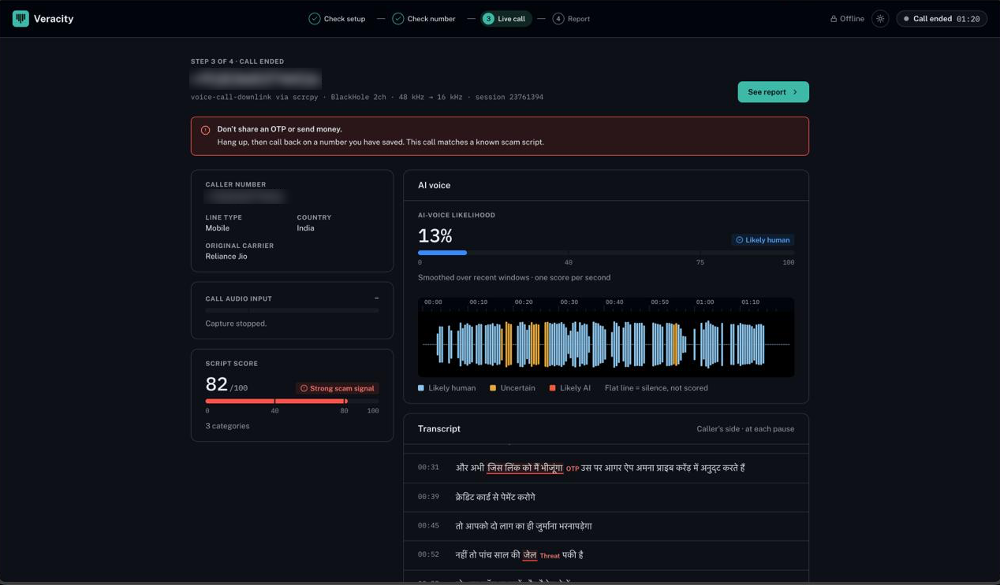

<sub>A real test call: a person reading a Hindi "digital arrest" script. The voice stays <b>Likely human</b>, the scam script is caught word for word, and the scam alert fires.</sub>

</div>

---

## Contents

1. [The problem](#1-the-problem)
2. [What Veracity does](#2-what-veracity-does)
3. [Results from a real call](#3-results-from-a-real-call)
4. [How it works](#4-how-it-works)
5. [Benchmarks](#5-benchmarks)
6. [Getting started](#6-getting-started)
7. [Connecting a real phone](#7-connecting-a-real-phone)
8. [Reference: configuration, API, report, project structure](#8-reference)
9. [Testing](#9-testing)
10. [Troubleshooting](#10-troubleshooting)
11. [Limitations and roadmap](#11-limitations-and-roadmap)
12. [Tech stack and credits](#12-tech-stack-and-credits)

---

## 1. The problem

| | |
| --- | --- |
| **₹22,845 crore** | lost by Indians to cyber fraud in 2024, three times the year before ([MHA, via Inc42](https://inc42.com/buzz/indians-lost-inr-22845-cr-to-cyber-fraud-in-2024-govt/)) |
| **1,23,672** | "digital arrest" cases in 2024, costing ₹1,918 crore ([I4C data, via ThePrint](https://theprint.in/india/governance/after-465-spike-in-2024-mha-data-shows-digital-arrest-scams-are-on-a-decline-in-india/2857002/)) |
| **47%** | of Indian adults have experienced, or know someone who experienced, an AI voice scam; 69% say they can't tell an AI voice from a real one ([McAfee, 2023](https://www.businesswire.com/news/home/20230501005587/en)) |
| **3 seconds** | of audio is enough to clone a voice ([McAfee](https://www.businesswire.com/news/home/20230501005587/en)) |

A scam call has three tells: a **suspicious number**, a **voice that may be synthetic**, and **words that follow a script** ("you are under digital arrest", "move your money to a safe account", "tell me the OTP"). Victims rarely notice them in the moment, and afterwards they have no evidence to report.

---

## 2. What Veracity does

Veracity listens to a normal call on an Android phone plugged into a laptop by USB, and while the call is still going on it shows:

| Signal | What the user sees | How |
| --- | --- | --- |
| **The number** | Validity, line type, India series (1600 / 140), original carrier, community reports, a risk score with its reasons | libphonenumber + transparent rules + SQLite |
| **The voice** | How likely the voice is AI-generated, updated every second, with a colour-coded timeline | wav2vec2 XLS-R deepfake model, calibrated and smoothed |
| **The words** | A live transcript with the caller's exact words highlighted when they match a scam script | Whisper → 11 scam-rule categories → local LLM |

When the call ends it builds a **JSON evidence report** with every score, every red flag and its exact words, and what to do next: call **1930** and file on **cybercrime.gov.in** if money was lost, otherwise report the number on **Chakshu** within 30 days.

**Everything runs on the laptop.** There are no cloud APIs, nothing goes online during a call, and audio is never saved unless the user turns that on.

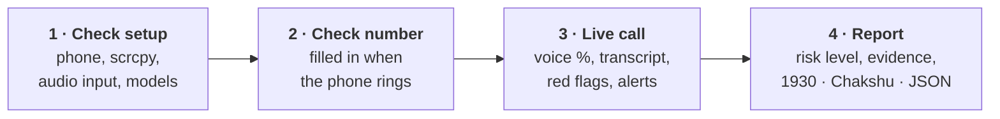

---

## 3. Results from a real call

**Test, 31 October 2026.** A person (no voice changer, no AI) called the Android phone from a Jio mobile and read a Hindi "digital arrest" script for 1 min 20 s. Audio was captured live with scrcpy (`voice-call-downlink`) through BlackHole at 48 kHz.

| Signal | What Veracity reported | Verdict |
| --- | --- | --- |
| **AI voice** | **Likely human** for the whole call. 76 windows scored; the smoothed score ended at 13% and never reached *Likely AI*. | ✅ Correct: the caller was human |
| **Transcript** | Hindi, one line per pause; readable, with some misheard words | ✅ Usable as evidence |
| **Red flags** | 4 flags in 3 categories, each with the exact words and time: police (00:06), arrest (00:19), "the link I'll send" (00:31), jail (00:52) | ✅ All four are real scam phrases |
| **Script score** | **82 / 100, Strong scam signal**; the scam alert fired during the call | ✅ |
| **Overall** | **High risk, 89 / 100** | ✅ |

This is the case that matters most: **when the scammer is a real person, the voice stays green and the script engine still catches the call.** Most scams are scripts.

<table>
  <tr>
    <td width="45%">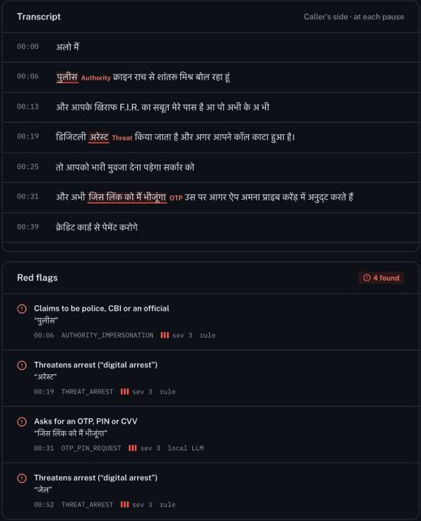</td>
    <td width="55%">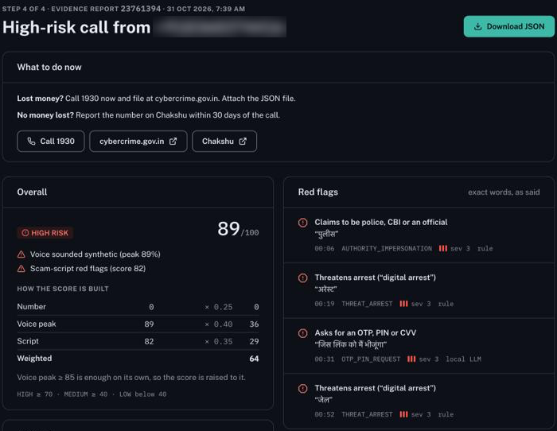<br/>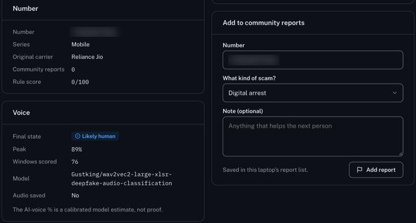</td>
  </tr>
  <tr>
    <td><sub>Transcript and red flags. Every flag quotes the caller's own words and links to the moment they were said.</sub></td>
    <td><sub>The evidence report shows how the score was built, so nobody has to trust a bare number.</sub></td>
  </tr>
</table>

### Before and after tuning

Both are real calls on the same phone, made by a real person reading a scam script.

| | First real call | Latest real call |
| --- | --- | --- |
| AI-voice verdict | ❌ Likely AI, 100% (false alarm) | ✅ **Likely human**, 13% |
| Transcript | ❌ Wrong languages ("Helo, m-am un vei polis…") | ✅ Hindi, one line per pause |
| Red flags | ❌ 1, with the wrong label | ✅ **4**, with exact words and times |
| Script score | 16 | **82**, and the alert fired |

What changed in between (all measured, see [Benchmarks](#5-benchmarks)):

- **Voice model:** we tested five deepfake detectors on phone-quality audio and switched to the one that stopped flagging real voices.
- **Speech-to-text:** a larger Whisper model, Hindi by default, no random-decoding fallback, and chunks cut at pauses so words aren't split.
- **Hindi-tolerant rules:** text and patterns are "folded" so Whisper's typical misspellings (दिजिटल आरेष्ट for डिजिटल अरेस्ट) still match.
- **A stricter LLM:** a flag is kept only if its quote is in one transcript line, isn't already used, and the model is confident.

---

## 4. How it works

### 4.1 System architecture

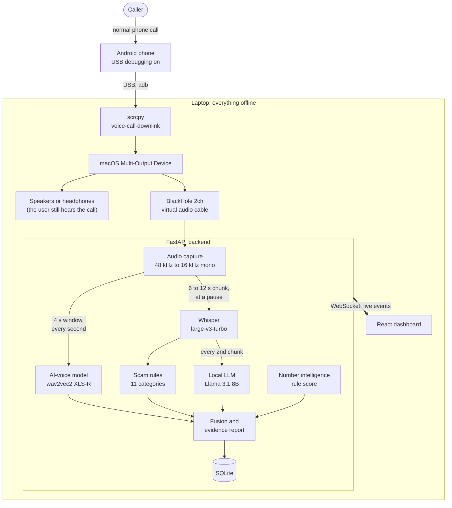

**Why a USB cable?** Android doesn't let ordinary apps record phone calls. `scrcpy` runs its capture code on the phone through `adb` (Android's developer connection), and since v3.2 it can capture the caller's side of a call. A product would need OEM or operator integration; for the prototype, a cable proves the whole pipeline end to end.

### 4.2 One call, start to finish

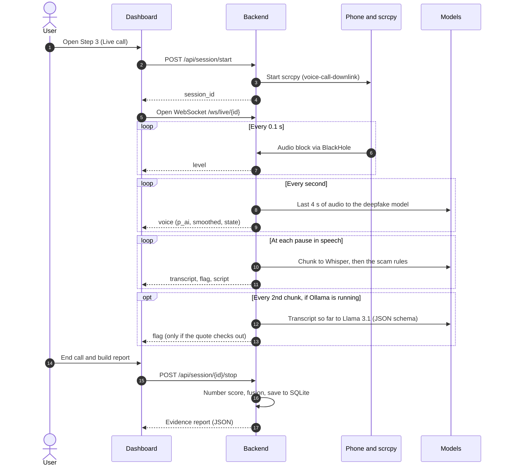

The live session runs three threads so a slow step never blocks a fast one:

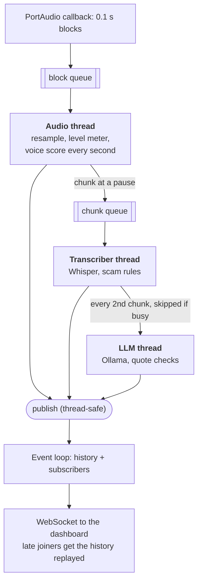

### 4.3 AI-voice detection

Every second, the last 4 seconds of audio are scored, calibrated and smoothed. A single noisy window can't raise an alarm: it takes three windows in a row.

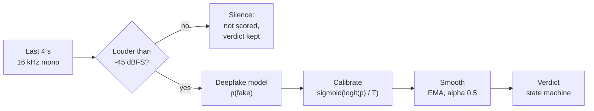

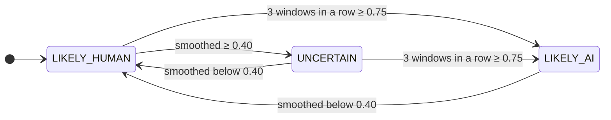

Once a call is *Likely AI*, one weaker window doesn't flip it back. It stays until the smoothed score drops below 0.40.

### 4.4 Scam-script detection

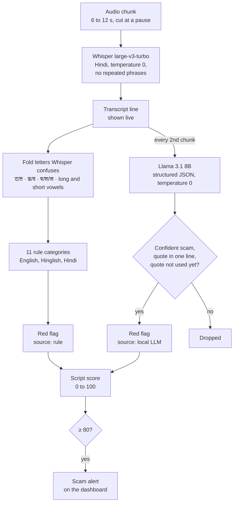

The highlighted evidence is always cut from the **original** transcript, never from the folded text, so it's exactly what Whisper heard.

| Category | Severity | Example triggers |
| --- | --- | --- |
| OTP / PIN request | 3 | OTP, CVV, UPI PIN, "code batao", ओटीपी |
| Authority impersonation | 3 | CBI, police, cyber crime, customs, पुलिस |
| Threat of arrest | 3 | digital arrest, warrant, जेल, गिरफ्तार |
| Payment pressure | 3 | safe account, transfer the money, पैसे भेजो |
| Remote access | 3 | AnyDesk, TeamViewer, screen share, APK |
| Secrecy | 2 | don't tell anyone, किसी को मत बताना |
| KYC / account block | 2 | KYC, account will be blocked, सिम बंद |
| Parcel / courier | 2 | parcel in your name, FedEx, पार्सल |
| Family emergency | 2 | accident, hospital, naya number |
| Prize / lottery | 2 | you have won, lottery, KBC |
| Urgency | 1 | right now, turant, तुरंत |

**Script score** = 8 × the sum of the severities of distinct categories, +20 for authority + payment (digital arrest), +20 for family emergency + payment (voice clone), +10 for an OTP or PIN request; at most 100.

### 4.5 Risk fusion

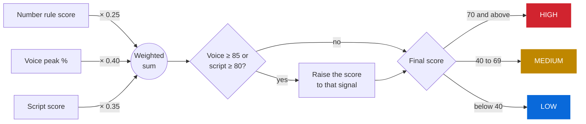

A single very strong signal is enough on its own; otherwise all three add up. The report page shows this calculation line by line.

**Number rule score** (transparent; every point comes with a reason):

| Signal | Points |
| --- | --- |
| Invalid or unparseable number | +40 |
| International number | +25 |
| Community reports | +10 × log2(1 + reports), at most +30 |
| Reported in the last 7 days | +10 |
| 140 telemarketing series | +5 |
| 1600 series (regulated banks and agencies) | −20 |

---

## 5. Benchmarks

The real-call result is in [§3](#3-results-from-a-real-call). The tables below are how we **chose** the models. They use simulated phone audio: real human speech (LibriSpeech) and synthetic speech (macOS voices), sent through a 300–3400 Hz filter, μ-law at 8 kHz and AAC. They were measured by us on 31 October 2026 on an Apple Silicon MacBook. Treat them as a starting point, not accuracy claims.

### AI-voice model

Share of 4-second windows scored ≥ 0.75 (the "AI" threshold) on phone-quality audio:

| Model | Real human voices (lower is better) | Synthetic voices (higher is better) |
| --- | --- | --- |
| mo-thecreator/Deepfake-audio-detection (first choice) | 26% | 100% |
| garystafford/wav2vec2-deepfake-voice-detector | 21% | 100% |
| Hemgg/Deepfake-audio-detection | 31% | 93% |
| MelodyMachine/Deepfake-audio-detection-V2 | 0% | 58% |
| **Gustking/wav2vec2-large-xlsr-deepfake-audio-classification (used)** | **1%** | **100%** |

It scores a window in **0.07 s** on Apple Silicon (Metal). It's built on XLS-R, which was pretrained on 128 languages including Hindi.

### Speech-to-text

A Hindi scam script on phone-quality audio, in 8-second chunks:

| Setup | Time per 8 s of audio | Characters wrong |
| --- | --- | --- |
| Whisper small, default settings | 6.8–9.8 s (falls behind) | 25–27%, with garbled chunks |
| Whisper small, tuned | 2.5 s | 22% |
| Whisper medium, tuned | 8.1 s (falls behind) | 21% |
| **Whisper large-v3-turbo, tuned (used)** | **5.0 s** | **10%** |

"Tuned" means: Hindi fixed instead of auto-detected; temperature 0 with one small retry instead of falling back to random decoding; no repeated 3-word phrases; and segments Whisper rates as non-speech dropped. On the test script, folding Whisper's misspellings took the rules from **0 to 7 red flags**, with no flags on everyday sentences such as "मेरे सारे पैसे खर्च हो गए".

---

## 6. Getting started

### Prerequisites

| Tool | Version | Why |
| --- | --- | --- |
| macOS on Apple Silicon | recommended | BlackHole audio routing; Metal for the voice model |
| [Python](https://www.python.org/downloads/) | 3.12 or 3.13 | Backend (tested on 3.13) |
| [Node.js](https://nodejs.org/) | 20.19+ | Frontend |
| [Ollama](https://ollama.com/) | recent | Optional local LLM; the rules work without it |
| Free disk | ≈ 9 GB | Voice model ≈ 1.3 GB, Whisper ≈ 1.6 GB, Llama 3.1 8B ≈ 4.9 GB |

### Install and run

```bash
git clone https://github.com/YADUNANDAN-SINGH/Veracity.git
cd Veracity/veracity-backend

python3 -m venv venv && source venv/bin/activate
pip install -r requirements.txt -r requirements-ml.txt

# Download the models once; after this everything works with Wi-Fi off
hf download Gustking/wav2vec2-large-xlsr-deepfake-audio-classification
python -c "from faster_whisper import WhisperModel; WhisperModel('large-v3-turbo', device='cpu', compute_type='int8')"
ollama pull llama3.1:8b        # optional

uvicorn main:app --reload --port 8000
```

In a second terminal:

```bash
cd Veracity/veracity-frontend/veracity
npm install
npm run dev
```

Open **<http://localhost:5173>**. Vite forwards `/api` and `/ws` to the backend, so there's nothing to configure. Interactive API docs are at <http://localhost:8000/docs>.

> If `hf` isn't found, your `huggingface_hub` is older: use `huggingface-cli download …` instead.

### Try it without a phone

- **Feed it speech:** set the Mac's sound output to BlackHole and play audio into it, for example `say -a "BlackHole 2ch" "You are under digital arrest. Transfer the money to a safe account."`. The backend treats this exactly like call audio.
- **Browser demo:** with an older backend that has no session API, Step 3 plays a scripted "digital arrest" call in the browser, clearly marked *Demo call*. Good for UI work.
- **Docker:** `docker compose up --build` runs the dashboard and backend for UI work. A backend in Docker can't see USB or audio devices, so live calls need the local backend.

---

## 7. Connecting a real phone

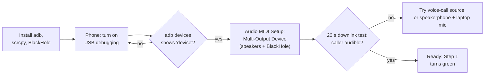

### 7.1 Install the tools

```bash
brew install --cask android-platform-tools   # adb
brew install scrcpy                          # 3.2 or newer
brew install blackhole-2ch                   # restart the Mac if it doesn't appear
```

### 7.2 Turn on USB debugging

Go to Settings → About phone and tap *Build number* 7 times (on Xiaomi it's *MIUI version*). Then open Developer options and turn on *USB debugging*; on Xiaomi, also *USB debugging (Security settings)*. Plug in with a data cable and accept the prompt. `adb devices` must list the phone as `device`.

### 7.3 Route the call audio into BlackHole

scrcpy plays the caller through the Mac's *current sound output*, so that output must include BlackHole:

1. Open **Audio MIDI Setup** → **+** → **Create Multi-Output Device**.
2. Tick your speakers or headphones **first**, then **BlackHole 2ch**. Turn on **Drift Correction** for BlackHole only.
3. Right-click the device → **Use This Device For Sound Output**, then restart the backend.
4. Allow **Microphone** access for the terminal when macOS asks, or BlackHole records silence.

If nothing reaches BlackHole for 6 seconds, Step 3 shows a **No call audio** banner that names the output the Mac is actually using.

### 7.4 Check this phone gives call audio

During a real call, run:

```bash
scrcpy --no-video --no-playback --require-audio --audio-source=voice-call-downlink \
  --audio-codec=aac --record=downlink_test.m4a --time-limit=20
```

You should hear the caller in `downlink_test.m4a`. If it's silent, retry with `--audio-source=voice-call` and run the backend with `VERA_AUDIO_SOURCE=voice-call`.

### 7.5 Monitor a call

In Step 1 all checks should be green; optionally turn on *Save audio*. Step 2 fills in the number when the phone rings. Step 3 starts scrcpy and starts listening. Finally, click **End call & build report**.

---

## 8. Reference

<details>
<summary><b>Configuration</b>: environment variables</summary>

<br/>

| Variable | Default | What it does |
| --- | --- | --- |
| `VERA_AUDIO_DEVICE` | `BlackHole 2ch` | Input device to record from |
| `VERA_AUDIO_SOURCE` | `voice-call-downlink` | scrcpy audio source; `voice-call` mixes both sides |
| `VERA_CAPTURE_METHOD` | `scrcpy_<source>` | Written to the report; a value not starting with `scrcpy` stops the backend from launching scrcpy |
| `VERA_VOICE_MODEL` | `Gustking/wav2vec2-large-xlsr-deepfake-audio-classification` | Hugging Face model for the AI-voice score |
| `VERA_VOICE_T` | `1.0` | Calibration temperature |
| `VERA_T_AI` | `0.75` | Window score that counts towards *Likely AI* |
| `VERA_T_UNCERTAIN` | `0.40` | Smoothed score for *Uncertain* |
| `VERA_WHISPER_MODEL` | `large-v3-turbo` | Whisper size; use `small` on a slower Mac |
| `VERA_WHISPER_THREADS` | up to 8 | CPU threads for Whisper |
| `VERA_LANGUAGE` | `hi` | `hi`, `en`, or `auto` to detect per chunk |
| `VERA_LLM_MODEL` | `llama3.1:8b` | Ollama model |
| `OLLAMA_HOST` | `http://localhost:11434` | Where Ollama runs |
| `VERA_DB` | `app/data/veracity.db` | SQLite file for community reports and saved reports |
| `VERA_FAKE` | unset | `1` lets Step 1 continue without a phone |

</details>

<details>
<summary><b>API</b>: REST endpoints and WebSocket events</summary>

<br/>

| Method | Path | Purpose |
| --- | --- | --- |
| GET | `/api/health` | Backend, phone, scrcpy, audio device and model status |
| GET | `/api/call/state` | `{connected, state, number}`, read from the phone over adb |
| POST | `/api/number/check` | `{number, region}` → facts, series, community reports, rule score and reasons |
| POST | `/api/number/report` | `{number, category, note}` → saves a community report |
| POST | `/api/session/start` | `{caller_number, save_audio}` → `{session_id}`; 503 if the audio input is missing |
| POST | `/api/session/{id}/stop` | Ends the call; returns and saves the report |
| GET | `/api/report/{id}` | A saved report; `?download=1` sends it as a file |
| WS | `/ws/live/{id}` | Live events; late joiners get the history replayed |

| Event | Fields | Dashboard |
| --- | --- | --- |
| `level` | `t, dbfs` | Input meter and waveform |
| `voice` | `t, p_ai, smoothed, state, speech` | AI-voice %, badge, timeline colour |
| `transcript` | `t, text` | Transcript line |
| `flag` | `category, severity, evidence, t, source` | Red-flag list and highlighted words |
| `script` | `score` | Script score |
| `alert` | `kind` (`voice`, `script`, `audio`), `message` | The one banner |
| `report` | `report` | Step 4 |
| `ended` | — | Closes the socket |

`t` is seconds since the call started. `state` is `LIKELY_HUMAN`, `UNCERTAIN` or `LIKELY_AI`.

</details>

<details>
<summary><b>Evidence report</b>: the JSON format</summary>

<br/>

```json
{
  "schema_version": "1.0",
  "report_id": "23761394…",
  "generated_at": "2026-10-31T02:09:00Z",
  "call":   { "caller_number": "+91…", "duration_s": 80.0,
              "capture_method": "scrcpy_voice_call_downlink", "audio_device": "BlackHole 2ch" },
  "number": { "e164": "+91…", "series": "mobile", "original_carrier": "Reliance Jio",
              "community_reports": 0, "rule_score": 0, "reasons": [] },
  "voice":  { "model_id": "Gustking/wav2vec2-large-xlsr-deepfake-audio-classification",
              "calibration_t": 1.0, "threshold": 0.75,
              "windows": [{ "t_start": 34.0, "t_end": 38.0, "p_ai": 0.0946 }, "…"],
              "max_p_ai": 0.89, "final_state": "LIKELY_HUMAN" },
  "script": { "script_score": 82,
              "red_flags": [{ "category": "THREAT_ARREST", "severity": 3, "evidence": "अरेस्ट",
                              "t": 19.0, "source": "rule" }, "…"],
              "transcript_excerpt": "…" },
  "overall":  { "risk_level": "HIGH", "score": 89, "top_reasons": ["…"] },
  "evidence": { "audio_saved": false, "audio_sha256": null },
  "next_steps": ["Lost money? Call 1930 now and file a complaint at https://cybercrime.gov.in. …",
                 "No money lost? Report the number on Chakshu … within 30 days of the call."],
  "disclaimer": "This report is evidence, not proof. …"
}
```

With **Save audio** on, the call is written to `app/data/audio/<id>.wav` and the report stores its SHA-256, so anyone can check the file wasn't changed.

</details>

<details>
<summary><b>Project structure</b></summary>

<br/>

```text
Veracity/
├── README.md
├── docs/screenshots/              images used in this README
├── docker-compose.yml
├── veracity-backend/              Python · FastAPI
│   ├── main.py                    app, routers; loads the models in the background
│   ├── requirements.txt           web, phone numbers, audio input
│   ├── requirements-ml.txt        torch, transformers, faster-whisper, scipy, ollama
│   ├── tests/test_report.py
│   └── app/
│       ├── routes/                web layer: health, call, number, session, report
│       ├── feature/               logic layer, no web code
│       │   ├── audio_capture.py   BlackHole capture, resampling, scrcpy start/stop
│       │   ├── voice.py           deepfake model, calibration, verdict smoother
│       │   ├── transcriber.py     faster-whisper tuned for Hindi phone audio
│       │   ├── scam_rules.py      11 categories, Hindi-tolerant matching, script score
│       │   ├── scam_llm.py        Ollama structured output, quote checking
│       │   ├── session.py         one live call: three threads → WebSocket events
│       │   ├── number_intelligence.py   libphonenumber, India series, rule score
│       │   ├── report.py          Pydantic report schema and fusion
│       │   ├── reports_db.py      SQLite: community reports, saved reports
│       │   └── call_state.py      ringing / in call / caller number over adb
│       └── data/                  git-ignored: veracity.db, audio/
└── veracity-frontend/veracity/    React 19 · Vite 8
    └── src/
        ├── api/                   one module per backend area (no React)
        ├── hooks/                 useHealth, useNumberCheck, useCallState, useLiveSession, useTheme
        ├── pages/                 SetupPage, NumberPage, LivePage, ReportPage
        ├── components/            layout, live, report, ui
        └── styles/tokens.css      every colour, light and dark
```

The backend keeps **web code** in `routes/` and **logic** in `feature/`, so every feature can be tested without a server. The frontend flows `api/` → `hooks/` → `pages/` → `components/`: if the backend renames a field, only `api/` changes.

</details>

---

## 9. Testing

```bash
cd veracity-backend
pip install pytest httpx      # first time
python -m pytest              # 13 tests

cd ../veracity-frontend/veracity
npm run lint && npm run build
```

The tests cover the number rule score against the project document's table, fusion and its overrides, the report schema, and the report and community-report endpoints, using a temporary database.

---

## 10. Troubleshooting

<details>
<summary>Open the troubleshooting table</summary>

<br/>

| Problem | Fix |
| --- | --- |
| **No call audio** banner, flat waveform | The Mac's sound output doesn't include BlackHole. Set up the Multi-Output Device ([§7](#7-connecting-a-real-phone)). |
| Flat waveform even with the Multi-Output Device | The phone isn't sharing call audio. Run the 20 s downlink test and try `VERA_AUDIO_SOURCE=voice-call`. Also check Microphone permission. |
| **Couldn't monitor this call** | BlackHole isn't installed, or was installed after the backend started. Restart the backend. |
| A real voice shown as *Likely AI* | The thresholds aren't calibrated for your phone yet. Record calls with *Save audio* on and tune `VERA_VOICE_T` / `VERA_T_AI`. |
| Transcript in the wrong language | Set `VERA_LANGUAGE` (`hi` or `en`). |
| Transcript lags behind the call | Use `VERA_WHISPER_MODEL=small`. |
| No *local LLM* flags | Start Ollama and run `ollama pull llama3.1:8b`. The rules work without it. |
| **No phone found** | Run `adb devices`; replug, set USB mode to *File transfer*, accept the debugging prompt. |
| **Can't reach the backend** | Start `uvicorn` on port 8000. |
| `address already in use` | Another copy (often Docker) is running: `docker compose stop`. |

</details>

---

## 11. Limitations and roadmap

### Known limitations

- **Not proof.** The AI-voice % is a model estimate meant to warn the user, not legal evidence. Every report says so.
- **Voice override uses the single highest window.** In the real-call test one 4-second window reached 89%, so the report's reasons include "voice sounded synthetic" even though the verdict stayed *Likely human* the whole call. The risk level was right either way (the script score of 82 is enough on its own), but the override should use the smoothed score.
- **Calibration.** The voice model and thresholds were chosen on simulated phone audio; they need calibrating on recordings from the phones and networks actually used.
- **Transcription.** Whisper still mishears narrow-band Hindi, and the rules only catch phrases on their list. The LLM can also pick the wrong category: it labelled "जिस लिंक को में भीजूंगा" ("the link I'll send") as an OTP request rather than a phishing link.
- **Spoofing.** Veracity checks the caller ID the network shows. It can't reveal the real number behind a spoofed call.
- **Hardware.** It needs a laptop and a cable today, and call-audio support varies by phone.

### Next steps

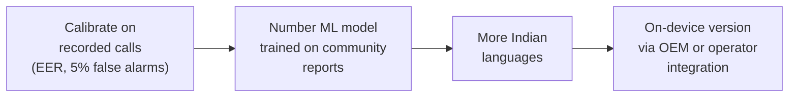

---

## 12. Tech stack and credits

| Part | Technology | Licence |
| --- | --- | --- |
| Backend | FastAPI, Pydantic v2, Uvicorn | MIT, MIT, BSD-3 |
| Dashboard | React 19, Vite 8 | MIT |
| Call audio | [scrcpy](https://github.com/Genymobile/scrcpy), [BlackHole](https://github.com/ExistentialAudio/BlackHole), sounddevice | Apache-2.0, GPL-3.0, MIT |
| AI voice | [Gustking/wav2vec2-large-xlsr-deepfake-audio-classification](https://huggingface.co/Gustking/wav2vec2-large-xlsr-deepfake-audio-classification), PyTorch, Transformers | Apache-2.0, BSD-3, Apache-2.0 |
| Speech-to-text | [faster-whisper](https://github.com/SYSTRAN/faster-whisper), Whisper large-v3-turbo | MIT |
| Local LLM | [Ollama](https://ollama.com/), Llama 3.1 8B | MIT, Llama 3.1 Community Licence |
| Phone numbers | [phonenumbers](https://github.com/daviddrysdale/python-phonenumbers) (libphonenumber) | Apache-2.0 |
| Storage | SQLite | Public domain |

**Principles we kept:**

- No external APIs at runtime.
- Privacy by default.
- We never quote accuracy we didn't measure ourselves.
- We say "Likely AI", never "confirmed fake".
- Every status pairs a colour with an icon and a word.

<div align="center">
<br/>
<sub>Built for Hackathon 2026 · 30–31 October 2026</sub>
</div>
