<div align="center">

# Veracity

**Hear the truth before you lose your money.**

Veracity listens to a phone call while it is happening and catches cloned voices and scam scripts.<br/>
If the caller asks for money, **Protected Send** has **PayPal** hold it until the call checks out.


<sub>A real test call: a person reading a Hindi "digital arrest" script. The voice stays <b>Likely human</b>, the scam script is caught word for word, and the scam alert fires.</sub>

**[Try it in your browser](https://YOUR-RENDER-SERVICE.onrender.com)** (judge mode, no install) · **[Demo video](https://youtu.be/YOUR-VIDEO-ID)** · [How PayPal is used](#3-protected-send-paypal-holds-the-money)

</div>

---

## Contents

1. [The problem](#1-the-problem)
2. [What Veracity does](#2-what-veracity-does)
3. [Protected Send: PayPal holds the money](#3-protected-send-paypal-holds-the-money)
4. [Results from a real call](#4-results-from-a-real-call)
5. [How it works](#5-how-it-works)
6. [Benchmarks and evaluation](#6-benchmarks-and-evaluation)
7. [Getting started](#7-getting-started)
8. [Connecting a real phone](#8-connecting-a-real-phone)
9. [Reference: configuration, API, report, project structure](#9-reference)
10. [Testing](#10-testing)
11. [Troubleshooting](#11-troubleshooting)
12. [Limitations and roadmap](#12-limitations-and-roadmap)
13. [Project history](#13-project-history)
14. [AI used, and how](#14-ai-used-and-how)
15. [Tech stack and credits](#15-tech-stack-and-credits)

---

## 1. The problem

| | |
| --- | --- |
| **$15.9 billion** | lost to fraud reported to the US FTC in 2025, a record, up from $12.5 billion in 2024 ([AARP, on FTC data](https://www.aarp.org/money/scams-fraud/fbi-ftc-report-2025-losses.html)) |
| **$7.7 billion** | lost by Americans aged 60 and over in 2025, about 60% more than in 2024 ([FBI IC3 2025, via AARP](https://www.aarp.org/money/scams-fraud/fbi-ftc-report-2025-losses.html)) |
| **$893 million** | lost to AI-related scams in 2025, including voice-cloned "family in distress" calls ([FBI IC3 2025, via AARP](https://www.aarp.org/money/scams-fraud/fbi-ftc-report-2025-losses.html)) |
| **₹22,845 crore** | lost by Indians to cyber fraud in 2024, three times the year before ([MHA, via Inc42](https://inc42.com/buzz/indians-lost-inr-22845-cr-to-cyber-fraud-in-2024-govt/)) |
| **1,23,672** | "digital arrest" cases in 2024, costing ₹1,918 crore ([I4C data, via ThePrint](https://theprint.in/india/governance/after-465-spike-in-2024-mha-data-shows-digital-arrest-scams-are-on-a-decline-in-india/2857002/)) |
| **47%** | of Indian adults have experienced, or know someone who experienced, an AI voice scam; 69% say they can't tell an AI voice from a real one ([McAfee, 2023](https://www.businesswire.com/news/home/20230501005587/en)) |
| **3 seconds** | of audio is enough to clone a voice ([McAfee](https://www.businesswire.com/news/home/20230501005587/en)) |

A scam call has three tells: a **suspicious number**, a **voice that may be synthetic**, and **words that follow a script** ("Grandma, I'm in jail, don't tell Mom", "you are under digital arrest", "move your money to a safe account"). Victims rarely notice them in the moment, the money leaves before anyone checks, and afterwards they have no evidence to report.

---

## 2. What Veracity does

Veracity listens to a normal call on an Android phone plugged into a laptop by USB, and while the call is still going on it shows:

| Signal | What the user sees | How |
| --- | --- | --- |
| **The number** | Validity, line type, country, India series (1600 / 140), original carrier, community reports, a risk score with its reasons | libphonenumber + transparent rules + SQLite |
| **The voice** | How likely the voice is AI-generated, updated every second, with a colour-coded timeline | wav2vec2 XLS-R deepfake model, calibrated and smoothed |
| **The words** | A live transcript with the caller's exact words highlighted when they match a scam script, in English, Hinglish and Hindi | Whisper → 11 scam-rule categories → local LLM |
| **The money** | **Protected Send**: a payment the caller pushes for is authorized with PayPal but held, and released only if the call checks out | PayPal Orders v2 (intent AUTHORIZE), Payments v2, Webhooks |

When the call ends it builds a **JSON evidence report** with every score, every red flag and its exact words, the PayPal ids of any payment made during the call, and what to do next for the user's region: in the US, the FTC, the FBI's IC3 and the Elder Fraud Hotline; in India, **1930**, **cybercrime.gov.in** and **Chakshu**.

**The call's audio never leaves the laptop**, and it is never saved unless the user turns that on. The only network calls are PayPal's, for the payment, and they carry the verdict, not the call.

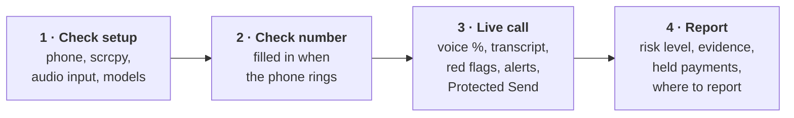

---

## 3. Protected Send: PayPal holds the money

Scammers need the money to move **during** the call, before the victim calls anyone back. So if the caller asks for money, the user sends it through Protected Send instead. The payer approves it in PayPal as usual, but Veracity only **authorizes** it: PayPal reserves the funds and **nothing is sent**. Then the call decides.

| The call when the payer approves | What happens to the money |
| --- | --- |
| Still going on, not high risk | **Held** until the call ends, then decided with the final report |
| Low risk, no scam signs | **Released**: the authorization is captured |
| Medium risk, or any scam signs in the caller's words (script score ≥ 40) | **Held** until the user calls the person back on the number saved in their phone. "They confirmed" releases it, "they didn't ask" voids it |
| High risk, an AI-sounding voice, or a known scam script (≥ 80) | **Held as a likely scam.** Even after a confirmed callback the money waits a 15-minute cooling-off |
| Nobody releases it within 72 hours | **Voided** automatically, inside PayPal's 3-day honor period |

Nobody can press "they confirmed" while the call is still going on, since the caller may be the one saying it; cancelling works at any time. The held screen quotes the caller's own words with their timestamps, so the user sees *why*, and shows the PayPal order, authorization and capture ids with every PayPal call, webhook and decision behind them.

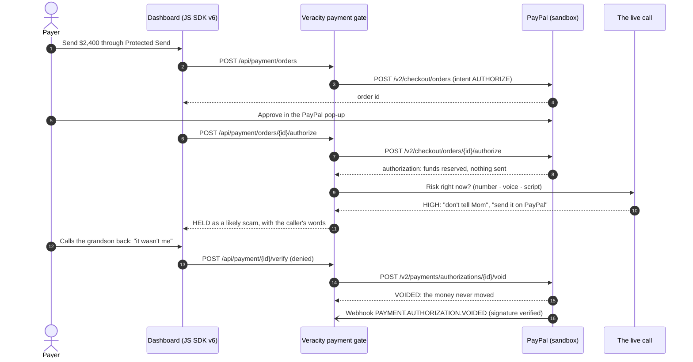

**PayPal APIs used**

| PayPal | Call | What Veracity uses it for | Code |
| --- | --- | --- | --- |
| JavaScript SDK v6 | `PayPalOneTimePaymentButton` | The payer approves in PayPal's own pop-up | `veracity-frontend/…/components/payment/ProtectedSend.jsx` |
| OAuth 2.0 | `POST /v1/oauth2/token` | Client-credentials token, cached until it expires | `app/feature/paypal_client.py` |
| Orders v2 | `POST /v2/checkout/orders` | An order with intent **AUTHORIZE**, so approving doesn't move money | `create_order` |
| Orders v2 | `POST /v2/checkout/orders/{id}/authorize` | Reserve the funds once the payer approves | `authorize_order` |
| Payments v2 | `POST /v2/payments/authorizations/{id}/capture` | **Release** a payment the call cleared | `capture_authorization` |
| Payments v2 | `POST /v2/payments/authorizations/{id}/void` | **Cancel**: the money never leaves the payer | `void_authorization` |
| Payments v2 | `GET /v2/payments/authorizations/{id}` | Ask PayPal the true state when a capture or void fails | `get_authorization` |
| Webhooks | `POST /v1/notifications/verify-webhook-signature` | Accept only events PayPal signed; each event is applied once | `verify_webhook_signature` |
| Payouts v1 (optional) | `POST /v1/payments/payouts` | Forward a release to the recipient's PayPal (`PAYPAL_PAYOUTS=1`) | `create_payout` |

Every request that moves money carries a `PayPal-Request-Id`, so a retry can never authorize, capture or void twice. The decision logic is `app/feature/payment_gate.py`; setup steps are in [docs/PAYPAL_SETUP.md](docs/PAYPAL_SETUP.md).

**What this is, honestly.** It runs in the PayPal sandbox with test money. Here the payer pays through Veracity's own checkout, because a third-party app can't pause a Friends-and-Family payment inside PayPal. In a real deployment Veracity's verdict ("this user is on a call that matches a scam, right now") would be a signal PayPal's own send flow consults, the way it already shows AI scam alerts on Friends and Family payments. Veracity adds the one thing a payment system can't see: the phone call.

---

## 4. Results from a real call

**Test, 31 October 2026.** A person (no voice changer, no AI) called the Android phone from a Jio mobile and read a Hindi "digital arrest" script for 1 min 20 s. Audio was captured live with scrcpy (`voice-call-downlink`) through BlackHole at 48 kHz.

| Signal | What Veracity reported | Verdict |
| --- | --- | --- |
| **AI voice** | **Likely human** for the whole call. 76 windows scored; the smoothed score ended at 13% and never reached *Likely AI*. | ✅ Correct: the caller was human |
| **Transcript** | Hindi, one line per pause; readable, with some misheard words | ✅ Usable as evidence |
| **Red flags** | 4 flags in 3 categories, each with the exact words and time: police (00:06), arrest (00:19), "the link I'll send" (00:31), jail (00:52) | ✅ All four are real scam phrases |
| **Script score** | **82 / 100, Strong scam signal**; the scam alert fired during the call | ✅ |
| **Overall** | **High risk, 89 / 100** | ✅ |

This is the case that matters most: **when the scammer is a real person, the voice stays green and the script engine still catches the call.** Most scams are scripts.

<table>
  <tr>
    <td width="45%">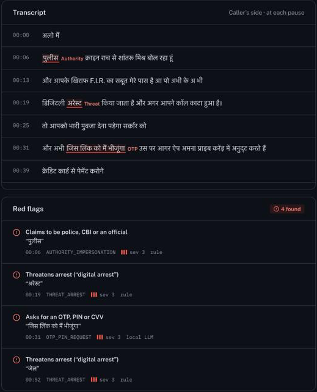</td>
    <td width="55%">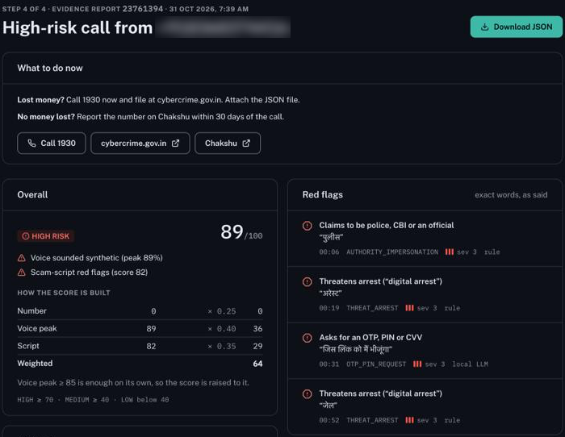<br/>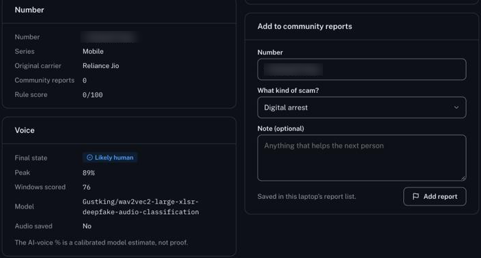</td>
  </tr>
  <tr>
    <td><sub>Transcript and red flags. Every flag quotes the caller's own words and links to the moment they were said.</sub></td>
    <td><sub>The evidence report shows how the score was built, so nobody has to trust a bare number.</sub></td>
  </tr>
</table>

### Before and after tuning

Both are real calls on the same phone, made by a real person reading a scam script.

| | First real call | Latest real call |
| --- | --- | --- |
| AI-voice verdict | ❌ Likely AI, 100% (false alarm) | ✅ **Likely human**, 13% |
| Transcript | ❌ Wrong languages ("Helo, m-am un vei polis…") | ✅ Hindi, one line per pause |
| Red flags | ❌ 1, with the wrong label | ✅ **4**, with exact words and times |
| Script score | 16 | **82**, and the alert fired |

What changed in between (all measured, see [Benchmarks](#6-benchmarks-and-evaluation)):

- **Voice model:** we tested five deepfake detectors on phone-quality audio and switched to the one that stopped flagging real voices.
- **Speech-to-text:** a larger Whisper model, Hindi by default, no random-decoding fallback, and chunks cut at pauses so words aren't split.
- **Hindi-tolerant rules:** text and patterns are "folded" so Whisper's typical misspellings (दिजिटल आरेष्ट for डिजिटल अरेस्ट) still match.
- **A stricter LLM:** a flag is kept only if its quote is in one transcript line, isn't already used, and the model is confident.

---

## 5. How it works

### 5.1 System architecture

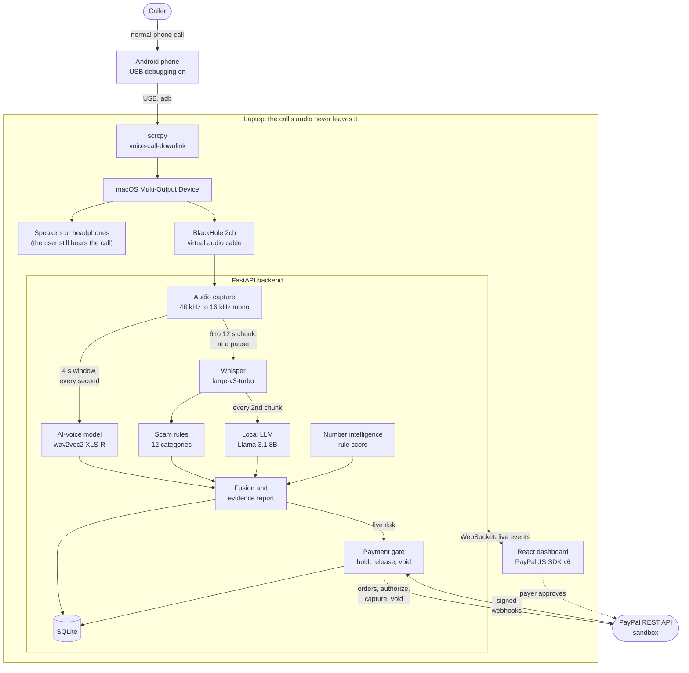

**Why a USB cable?** Android doesn't let ordinary apps record phone calls. `scrcpy` runs its capture code on the phone through `adb` (Android's developer connection), and since v3.2 it can capture the caller's side of a call. A product would need OEM or operator integration; for the prototype, a cable proves the whole pipeline end to end.

### 5.2 One call, start to finish

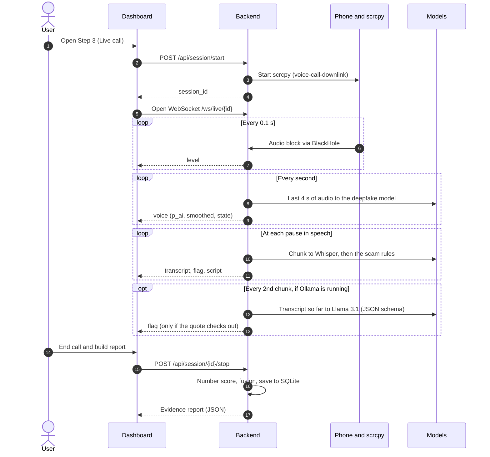

The live session runs three threads so a slow step never blocks a fast one:

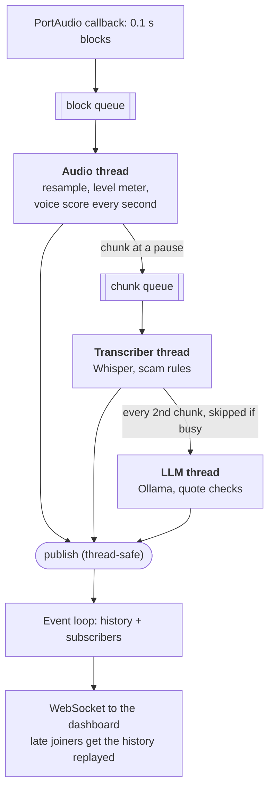

### 5.3 AI-voice detection

Every second, the last 4 seconds of audio are scored, calibrated and smoothed. A single noisy window can't raise an alarm: it takes three windows in a row.

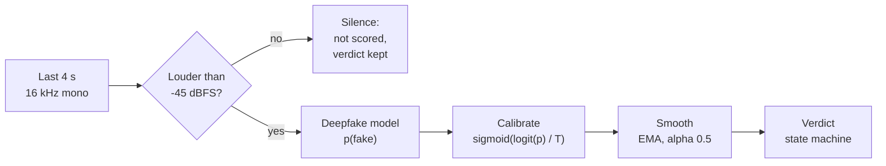

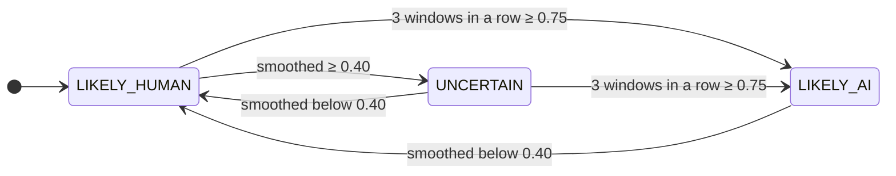

Once a call is *Likely AI*, one weaker window doesn't flip it back. It stays until the smoothed score drops below 0.40.

### 5.4 Scam-script detection

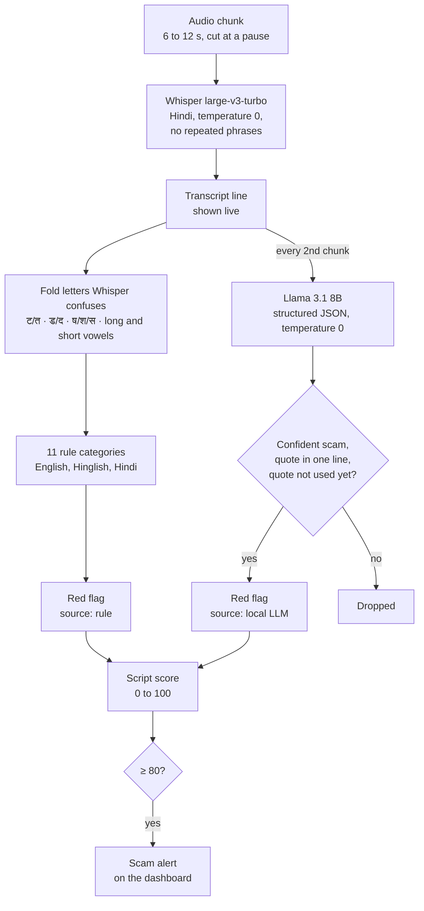

The highlighted evidence is always cut from the **original** transcript, never from the folded text, so it's exactly what Whisper heard.

| Category | Severity | Example triggers (US and India) |
| --- | --- | --- |
| OTP / PIN request | 3 | verification code, OTP, CVV, UPI PIN, "code batao", ओटीपी |
| Authority impersonation | 3 | IRS, FBI, sheriff, lawyer, CBI, police, customs, पुलिस |
| Threat of arrest | 3 | arrest, custody, digital arrest, warrant, जेल, गिरफ्तार |
| Payment pressure | 3 | "send it on PayPal / Venmo / Zelle", "send $2,400", wire, safe account, पैसे भेजो |
| Remote access | 3 | remote access, AnyDesk, TeamViewer, screen share, APK |
| Secrecy | 2 | "don't tell Mom", "stay on the line", don't tell anyone, किसी को मत बताना |
| KYC / account block | 2 | "your account was compromised", suspicious activity, KYC, सिम बंद |
| Parcel / courier | 2 | parcel in your name, FedEx, पार्सल |
| Family emergency | 2 | accident, bail, "broke my nose", new number, naya number |
| Prize / lottery | 2 | you have won, sweepstakes, lottery, KBC |
| Urgency | 1 | right now, ASAP, "before the judge", turant, तुरंत |

**Script score** = 8 × the sum of the severities of distinct categories, +20 for authority + payment (digital arrest), +20 for family emergency + payment (voice clone), +10 for an OTP or PIN request; at most 100.

### 5.5 Risk fusion

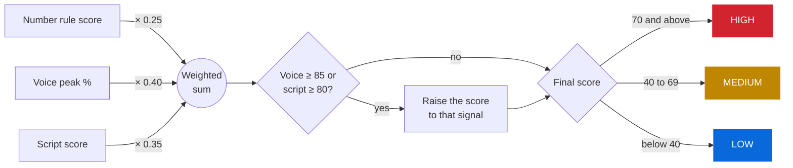

A single very strong signal is enough on its own; otherwise all three add up. The report page shows this calculation line by line.

**Number rule score** (transparent; every point comes with a reason):

| Signal | Points |
| --- | --- |
| Invalid or unparseable number | +40 |
| International number | +25 |
| Community reports | +10 × log2(1 + reports), at most +30 |
| Reported in the last 7 days | +10 |
| 140 telemarketing series | +5 |
| 1600 series (regulated banks and agencies) | −20 |

### 5.6 The payment gate

The risk level above drives the banner and the report. A payment needs a stricter level, because a scam told by a real person from a clean number can fuse to LOW: number 0, voice peak 15% and a script score of 68 (a "grandchild in jail" call) add up to **30, LOW**. Nobody should send money on that call, so `gate_level` also looks at the voice and the script on their own:

| On the call | Level for a payment | Payment |
| --- | --- | --- |
| Call risk HIGH, voice *Likely AI*, or script ≥ 80 | HIGH | Held as a likely scam |
| Call risk MEDIUM, or script ≥ 40 | MEDIUM | Held for a callback |
| Anything else | LOW | Released |

On the evaluation set in [§6](#6-benchmarks-and-evaluation), script ≥ 40 holds 21 of the 24 scam calls and none of the 24 ordinary ones.

The gate reads the call's risk the moment PayPal authorizes, and keeps each hold up to date:

- A payment held because the call was still going on is decided again, with the final report, when the call ends.
- If that call turns high risk while the payment waits, the hold becomes *likely scam*. Holds for a callback or a likely scam are only released by the payer, after the callback.
- Every held payment is checked once a minute and on every read, so a cooling-off ends and a 72-hour hold runs out even with the dashboard closed.
- If PayPal rejects a capture or a void, the gate asks PayPal for the authorization's real status and records that, instead of guessing.

---

## 6. Benchmarks and evaluation

The real-call result is in [§4](#4-results-from-a-real-call). The first two tables below are how we **chose** the models. They use simulated phone audio: real human speech (LibriSpeech) and synthetic speech (macOS voices), sent through a 300–3400 Hz filter, μ-law at 8 kHz and AAC. They were measured by us on 31 October 2026 on an Apple Silicon MacBook. Treat them as a starting point, not accuracy claims.

### AI-voice model

Share of 4-second windows scored ≥ 0.75 (the "AI" threshold) on phone-quality audio:

| Model | Real human voices (lower is better) | Synthetic voices (higher is better) |
| --- | --- | --- |
| mo-thecreator/Deepfake-audio-detection (first choice) | 26% | 100% |
| garystafford/wav2vec2-deepfake-voice-detector | 21% | 100% |
| Hemgg/Deepfake-audio-detection | 31% | 93% |
| MelodyMachine/Deepfake-audio-detection-V2 | 0% | 58% |
| **Gustking/wav2vec2-large-xlsr-deepfake-audio-classification (used)** | **1%** | **100%** |

It scores a window in **0.07 s** on Apple Silicon (Metal). It's built on XLS-R, which was pretrained on 128 languages including Hindi.

### Speech-to-text

A Hindi scam script on phone-quality audio, in 8-second chunks:

| Setup | Time per 8 s of audio | Characters wrong |
| --- | --- | --- |
| Whisper small, default settings | 6.8–9.8 s (falls behind) | 25–27%, with garbled chunks |
| Whisper small, tuned | 2.5 s | 22% |
| Whisper medium, tuned | 8.1 s (falls behind) | 21% |
| **Whisper large-v3-turbo, tuned (used)** | **5.0 s** | **10%** |

"Tuned" means: Hindi fixed instead of auto-detected; temperature 0 with one small retry instead of falling back to random decoding; no repeated 3-word phrases; and segments Whisper rates as non-speech dropped. On the test script, folding Whisper's misspellings took the rules from **0 to 7 red flags**, with no flags on everyday sentences such as "मेरे सारे पैसे खर्च हो गए".

### Scam-script rules on 48 test calls

`python eval/run_rules_eval.py` runs every call in [`eval/transcripts.jsonl`](eval/transcripts.jsonl) through the rules exactly as a live call does, and writes [`eval/results.md`](eval/results.md):

| Threshold | Scam calls caught | Ordinary calls flagged |
| --- | ---: | ---: |
| Live scam alert (script ≥ 80) | 6 / 24 (25%) | 0 / 24 |
| Protected Send holds for a callback (script ≥ 40) | **21 / 24 (88%)** | **0 / 24** |

The 48 calls are 24 scams and 24 ordinary calls that use the same words (a real bank's fraud check, a delivery driver, a friend asking for $20), in US English, Indian English, Hinglish and Hindi. **They were written for this test, with AI assistance, not recorded from real calls**, and the rules were tuned on similar phrasing, so real-world recall will be lower. The red banner is deliberately strict; the payment gate holds at 40, which is why it doesn't wait for the banner.

### The voice model on your own recordings

The voice table above used synthetic voices from macOS, not cloned voices. To measure the model on clones, put WAVs of real voices in one folder and cloned voices (made with consent) in another:

```bash
cd veracity-backend && source venv/bin/activate
python ../eval/voice_eval.py --real recordings/real --ai recordings/ai --telephone
```

It scores each file the way a live call does (a 4 s window every second, calibrated, silence skipped, then the live smoother) and writes `eval/voice_results.md` with ROC AUC, the equal error rate, and how many calls turned *Likely AI*. `--telephone` first sends the audio through a 300–3400 Hz, 8 kHz μ-law phone channel.

---

## 7. Getting started

### Try it in two minutes: the judge build

No phone, no models, no install beyond Docker. It replays recorded sample calls through the real scam rules, risk fusion and payment gate, in US mode:

```bash
git clone https://github.com/YADUNANDAN-SINGH/Veracity.git && cd Veracity
docker build -t veracity .
docker run --rm -p 8000:8000 veracity
# With PayPal sandbox keys, Protected Send works too (docs/PAYPAL_SETUP.md):
docker run --rm -p 8000:8000 -e PAYPAL_CLIENT_ID=... -e PAYPAL_CLIENT_SECRET=... veracity
```

Open **<http://localhost:8000>**, pick the *grandparent* sample call, and send the $2,400 the caller asks for. The [hosted demo](https://YOUR-RENDER-SERVICE.onrender.com) is this same container on Render ([`render.yaml`](render.yaml)).

Without Docker, the same build runs from the repo:

```bash
(cd veracity-frontend/veracity && npm ci && npm run build)
cd veracity-backend && python3 -m venv venv && source venv/bin/activate
pip install -r requirements-judge.txt
VERA_MODE=judge VERA_REGION=US VERA_STATIC_DIR=../veracity-frontend/veracity/dist uvicorn main:app --port 8000
```

Every replayed call is labelled *Replayed call* on screen and in its report. A replay shows a voice score only when the sample has one recorded, and you can type the caller's next line to see the rules react.

### Prerequisites

| Tool | Version | Why |
| --- | --- | --- |
| macOS on Apple Silicon | recommended | BlackHole audio routing; Metal for the voice model |
| [Python](https://www.python.org/downloads/) | 3.12 or 3.13 | Backend (tested on 3.13) |
| [Node.js](https://nodejs.org/) | 20.19+ | Frontend |
| [Ollama](https://ollama.com/) | recent | Optional local LLM; the rules work without it |
| Free disk | ≈ 9 GB | Voice model ≈ 1.3 GB, Whisper ≈ 1.6 GB, Llama 3.1 8B ≈ 4.9 GB |

### Install and run

```bash
git clone https://github.com/YADUNANDAN-SINGH/Veracity.git
cd Veracity/veracity-backend

python3 -m venv venv && source venv/bin/activate
pip install -r requirements.txt -r requirements-ml.txt

# Download the models once; after this everything works with Wi-Fi off
hf download Gustking/wav2vec2-large-xlsr-deepfake-audio-classification
python -c "from faster_whisper import WhisperModel; WhisperModel('large-v3-turbo', device='cpu', compute_type='int8')"
ollama pull llama3.1:8b        # optional

uvicorn main:app --reload --port 8000
```

In a second terminal:

```bash
cd Veracity/veracity-frontend/veracity
npm install
npm run dev
```

Open **<http://localhost:5173>**. Vite forwards `/api` and `/ws` to the backend, so there's nothing to configure. Interactive API docs are at <http://localhost:8000/docs>.

> If `hf` isn't found, your `huggingface_hub` is older: use `huggingface-cli download …` instead.

To use Protected Send locally, copy `veracity-backend/.env.example` to `.env`, fill in the PayPal sandbox values ([docs/PAYPAL_SETUP.md](docs/PAYPAL_SETUP.md)) and start the backend with `uvicorn main:app --reload --port 8000 --env-file .env`.

### Try it without a phone

- **Replay a sample call:** start the backend with `VERA_FAKE=1` and Step 2 offers the sample calls. The real scam rules, fusion and payment gate run on them; `VERA_SCENARIO=grandparent_us` picks the default. To replay a real recording with the real models' scores, see [`app/scenarios/README.md`](veracity-backend/app/scenarios/README.md) and `scripts/build_replay.py`.
- **Feed it speech:** set the Mac's sound output to BlackHole and play audio into it, for example `say -a "BlackHole 2ch" "Grandma, it's me. Don't tell Mom. Can you send it on PayPal right now?"`. The backend treats this exactly like call audio.
- **Docker:** the root `Dockerfile` is the judge build above. `docker compose up --build` runs the dashboard and backend for UI work; a backend in Docker can't see USB or audio devices, so live calls need the local backend.

---

## 8. Connecting a real phone

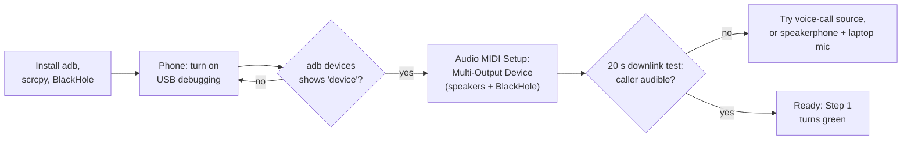

### 8.1 Install the tools

```bash
brew install --cask android-platform-tools   # adb
brew install scrcpy                          # 3.2 or newer
brew install blackhole-2ch                   # restart the Mac if it doesn't appear
```

### 8.2 Turn on USB debugging

Go to Settings → About phone and tap *Build number* 7 times (on Xiaomi it's *MIUI version*). Then open Developer options and turn on *USB debugging*; on Xiaomi, also *USB debugging (Security settings)*. Plug in with a data cable and accept the prompt. `adb devices` must list the phone as `device`.

### 8.3 Route the call audio into BlackHole

scrcpy plays the caller through the Mac's *current sound output*, so that output must include BlackHole:

1. Open **Audio MIDI Setup** → **+** → **Create Multi-Output Device**.
2. Tick your speakers or headphones **first**, then **BlackHole 2ch**. Turn on **Drift Correction** for BlackHole only.
3. Right-click the device → **Use This Device For Sound Output**, then restart the backend.
4. Allow **Microphone** access for the terminal when macOS asks, or BlackHole records silence.

If nothing reaches BlackHole for 6 seconds, Step 3 shows a **No call audio** banner that names the output the Mac is actually using.

### 8.4 Check this phone gives call audio

During a real call, run:

```bash
scrcpy --no-video --no-playback --require-audio --audio-source=voice-call-downlink \
  --audio-codec=aac --record=downlink_test.m4a --time-limit=20
```

You should hear the caller in `downlink_test.m4a`. If it's silent, retry with `--audio-source=voice-call` and run the backend with `VERA_AUDIO_SOURCE=voice-call`.

### 8.5 Monitor a call

In Step 1 all checks should be green; optionally turn on *Save audio*. Step 2 fills in the number when the phone rings. Step 3 starts scrcpy and starts listening; if the caller asks for money, send it from the **Protected Send** panel on the same screen. Finally, click **End call & build report**.

---

## 9. Reference

<details>
<summary><b>Configuration</b>: environment variables</summary>

<br/>

| Variable | Default | What it does |
| --- | --- | --- |
| `VERA_AUDIO_DEVICE` | `BlackHole 2ch` | Input device to record from |
| `VERA_AUDIO_SOURCE` | `voice-call-downlink` | scrcpy audio source; `voice-call` mixes both sides |
| `VERA_CAPTURE_METHOD` | `scrcpy_<source>` | Written to the report; a value not starting with `scrcpy` stops the backend from launching scrcpy |
| `VERA_VOICE_MODEL` | `Gustking/wav2vec2-large-xlsr-deepfake-audio-classification` | Hugging Face model for the AI-voice score |
| `VERA_VOICE_T` | `1.0` | Calibration temperature |
| `VERA_T_AI` | `0.75` | Window score that counts towards *Likely AI* |
| `VERA_T_UNCERTAIN` | `0.40` | Smoothed score for *Uncertain* |
| `VERA_WHISPER_MODEL` | `large-v3-turbo` | Whisper size; use `small` on a slower Mac |
| `VERA_WHISPER_THREADS` | up to 8 | CPU threads for Whisper |
| `VERA_LANGUAGE` | `hi` | `hi`, `en`, or `auto` to detect per chunk |
| `VERA_LLM_MODEL` | `llama3.1:8b` | Ollama model |
| `OLLAMA_HOST` | `http://localhost:11434` | Where Ollama runs |
| `VERA_DB` | `app/data/veracity.db` | SQLite file for community reports, saved reports and payments |
| `VERA_FAKE` | unset | `1` lets Step 1 continue without a phone, and Step 3 replays a sample call |
| `VERA_REGION` | `IN` | `US` or `IN`: how numbers are read, and which next steps and reporting links the report gives |
| `VERA_MODE` | unset | `judge`: the hosted build. Replays sample calls, skips hardware checks and model loading |
| `VERA_SCENARIO` | `grandparent_us` (US) or `digital_arrest_in` (IN) | The sample call a replay starts with |
| `VERA_REPLAY_SPEED` | `1` | `2` replays a call twice as fast |
| `VERA_STATIC_DIR` | unset | A built dashboard (`dist/`) for the backend to serve, as the judge build does |
| `PAYPAL_CLIENT_ID`, `PAYPAL_CLIENT_SECRET` | unset | PayPal **sandbox** REST app; without them Protected Send says it isn't set up |
| `PAYPAL_WEBHOOK_ID` | unset | Turns on `/api/paypal/webhook` and its signature check |
| `PAYPAL_PAYOUTS` | `0` | `1`: after a release, forward the money to the recipient's PayPal email with Payouts |
| `VERA_CURRENCY` | `USD` | Protected Send's default currency (USD, GBP, EUR, CAD or AUD) |
| `VERA_HOLD_HOURS` | `72` | A hold nobody releases is voided after this long; 72 at most, PayPal's honor period |
| `VERA_COOL_OFF_MIN` | `15` | How long a likely-scam payment still waits after a confirmed callback |
| `VERA_SANDBOX_BUYER_EMAIL`, `VERA_SANDBOX_BUYER_PASSWORD` | unset | A **sandbox** test buyer the judge build shows judges, so they can approve a test payment |

</details>

<details>
<summary><b>API</b>: REST endpoints and WebSocket events</summary>

<br/>

| Method | Path | Purpose |
| --- | --- | --- |
| GET | `/api/health` | Backend, phone, scrcpy, audio device and model status; mode, region and PayPal setup |
| GET | `/api/call/state` | `{connected, state, number}`, read from the phone over adb |
| POST | `/api/number/check` | `{number, region?}` → facts, series, community reports, rule score and reasons |
| POST | `/api/number/report` | `{number, category, note}` → saves a community report |
| GET | `/api/session/scenarios` | Sample calls that can be replayed, and the default one |
| POST | `/api/session/start` | `{caller_number, save_audio, scenario?}` → `{session_id, replay}`; 503 if the audio input is missing |
| POST | `/api/session/{id}/say` | `{text}` → a replayed call hears it as the caller's next words |
| GET | `/api/session/{id}/risk` | The call's risk so far: level, score, voice, script and top red flags |
| POST | `/api/session/{id}/stop` | Ends the call, decides payments that waited for it; returns and saves the report |
| GET | `/api/report/{id}` | A saved report; `?download=1` sends it as a file |
| WS | `/ws/live/{id}` | Live events; late joiners get the history replayed |
| GET | `/api/payment/config` | Whether PayPal is set up, the sandbox client id, currencies, hold policy |
| POST | `/api/payment/orders` | `{amount, currency, recipient_name, recipient_email?, contact_name, contact_number, note?, session_id}` → a PayPal order (intent AUTHORIZE) |
| POST | `/api/payment/orders/{order_id}/authorize` | After the payer approves: authorize, then hold or release by the call's risk |
| GET | `/api/payment?session_id=` | A call's payments, each with its policy and audit trail |
| GET | `/api/payment/{id}` | One payment, brought up to date (cooling-off, expiry, escalation) |
| POST | `/api/payment/{id}/verify` | `{outcome: "confirmed" \| "denied"}` after calling the person back: release or void |
| POST | `/api/payment/{id}/cancel` | Void the authorization: no money moves |
| POST | `/api/paypal/webhook` | PayPal webhooks; the signature is checked with PayPal before anything changes |

| Event | Fields | Dashboard |
| --- | --- | --- |
| `mode` | `replay, scenario, title, source, voice_scored, region` | First event of a replayed call: the *Replayed call* banner |
| `level` | `t, dbfs` | Input meter and waveform |
| `voice` | `t, p_ai, smoothed, state, speech` | AI-voice %, badge, timeline colour |
| `transcript` | `t, text` | Transcript line |
| `flag` | `category, severity, evidence, t, source` | Red-flag list and highlighted words |
| `script` | `score` | Script score |
| `alert` | `kind` (`voice`, `script`, `audio`), `message` | The one banner |
| `report` | `report` | Step 4 |
| `ended` | — | Closes the socket |

`t` is seconds since the call started. `state` is `LIKELY_HUMAN`, `UNCERTAIN` or `LIKELY_AI`.

</details>

<details>
<summary><b>Evidence report</b>: the JSON format</summary>

<br/>

```json
{
  "schema_version": "1.0",
  "report_id": "23761394…",
  "generated_at": "2026-10-31T02:09:00Z",
  "call":   { "caller_number": "+91…", "duration_s": 80.0,
              "capture_method": "scrcpy_voice_call_downlink", "audio_device": "BlackHole 2ch" },
  "number": { "e164": "+91…", "series": "mobile", "original_carrier": "Reliance Jio",
              "community_reports": 0, "rule_score": 0, "reasons": [] },
  "voice":  { "model_id": "Gustking/wav2vec2-large-xlsr-deepfake-audio-classification",
              "calibration_t": 1.0, "threshold": 0.75,
              "windows": [{ "t_start": 34.0, "t_end": 38.0, "p_ai": 0.0946 }, "…"],
              "max_p_ai": 0.89, "final_state": "LIKELY_HUMAN" },
  "script": { "script_score": 82,
              "red_flags": [{ "category": "THREAT_ARREST", "severity": 3, "evidence": "अरेस्ट",
                              "t": 19.0, "source": "rule" }, "…"],
              "transcript_excerpt": "…" },
  "overall":  { "risk_level": "HIGH", "score": 89, "top_reasons": ["…"] },
  "evidence": { "audio_saved": false, "audio_sha256": null },
  "region": "IN",
  "payments": [],
  "next_steps": ["Lost money? Call 1930 now and file a complaint at https://cybercrime.gov.in. …",
                 "No money lost? Report the number on Chakshu … within 30 days of the call."],
  "report_links": [{ "label": "Call 1930", "href": "tel:1930" }, "…"],
  "disclaimer": "This report is evidence, not proof. …"
}
```

With **Save audio** on, the call is written to `app/data/audio/<id>.wav` and the report stores its SHA-256, so anyone can check the file wasn't changed.

A payment made during the call appears in `payments` with its PayPal ids and outcome:

```json
{ "payment_id": "…", "status": "VOIDED", "amount": "2400.00", "currency": "USD",
  "recipient_name": "Jake (grandson)", "hold_reason": null, "verification": "denied",
  "paypal": { "order_id": "5O190127TN364715T", "authorization_id": "0VF52814937998046",
              "capture_id": null, "payout_batch_id": null } }
```

In US mode, `next_steps` and `report_links` point to ReportFraud.ftc.gov, ic3.gov and the Elder Fraud Hotline (1-833-372-8311).

</details>

<details>
<summary><b>Project structure</b></summary>

<br/>

```text
Veracity/
├── README.md · LICENSE (MIT)
├── Dockerfile · render.yaml       the hosted judge build: one container, Render Blueprint
├── docs/
│   ├── PAYPAL_SETUP.md            sandbox app, test buyer, webhooks, Payouts, deploying
│   └── screenshots/               images used in this README
├── eval/
│   ├── transcripts.jsonl          48 test calls: 24 scams, 24 ordinary
│   ├── run_rules_eval.py          → results.md
│   └── voice_eval.py              the voice model on your own recordings → voice_results.md
├── docker-compose.yml
├── veracity-backend/              Python · FastAPI
│   ├── main.py                    app, routers, held-payment sweeper; serves the dashboard in judge mode
│   ├── requirements.txt           web, phone numbers, audio input, HTTP client for PayPal
│   ├── requirements-ml.txt        torch, transformers, faster-whisper, scipy, ollama
│   ├── requirements-judge.txt     the judge build: no audio input, no models
│   ├── .env.example               every PayPal and Veracity setting
│   ├── scripts/build_replay.py    a recorded call → a replay scenario with the real models' output
│   ├── tests/                     95 tests; fake_paypal.py stands in for PayPal
│   └── app/
│       ├── routes/                web layer: health, call, number, session, report, payment
│       ├── scenarios/             sample calls for replays (format in its README)
│       ├── feature/               logic layer, no web code
│       │   ├── audio_capture.py   BlackHole capture, resampling, scrcpy start/stop
│       │   ├── voice.py           deepfake model, calibration, verdict smoother
│       │   ├── transcriber.py     faster-whisper tuned for Hindi phone audio
│       │   ├── scam_rules.py      12 categories, US and Indian scripts, Hindi-tolerant matching
│       │   ├── scam_llm.py        Ollama structured output, quote checking
│       │   ├── session.py         one live call: three threads → WebSocket events, live risk
│       │   ├── replay.py          a sample call through the same pipeline, no phone needed
│       │   ├── paypal_client.py   PayPal REST: OAuth, Orders v2, Payments v2, Payouts, webhooks
│       │   ├── payment_gate.py    hold, release or void by the call's risk; audit trail
│       │   ├── payments_db.py     SQLite: payments, PayPal events, webhook ids seen
│       │   ├── number_intelligence.py   libphonenumber, India series, rule score
│       │   ├── report.py          Pydantic report schema, fusion, next steps per region
│       │   ├── reports_db.py      SQLite: community reports, saved reports
│       │   └── call_state.py      ringing / in call / caller number over adb
│       └── data/                  git-ignored: veracity.db, audio/
└── veracity-frontend/veracity/    React 19 · Vite 8 · PayPal JS SDK v6
    └── src/
        ├── api/                   one module per backend area (no React)
        ├── hooks/                 useHealth, useNumberCheck, useCallState, useLiveSession, usePayments, …
        ├── pages/                 SetupPage, NumberPage, LivePage, ReportPage
        ├── components/            layout, live, payment, report, ui
        └── styles/tokens.css      every colour, light and dark
```

The backend keeps **web code** in `routes/` and **logic** in `feature/`, so every feature can be tested without a server. The frontend flows `api/` → `hooks/` → `pages/` → `components/`: if the backend renames a field, only `api/` changes.

</details>

---

## 10. Testing

```bash
cd veracity-backend
pip install pytest            # first time
python -m pytest              # 95 tests, no phone, models or PayPal account needed

cd ..
python eval/run_rules_eval.py # the scam rules on 48 test calls → eval/results.md

cd veracity-frontend/veracity
npm run lint && npm run build
```

What the tests cover:

- **The payment gate, end to end through the API**, against `tests/fake_paypal.py`, a stand-in for PayPal's sandbox: the hold policy for every risk level; a scam call held and voided after a "didn't ask" callback; the cooling-off; payments made mid-call waiting for the call to end; escalation when a call turns into a scam; expiry by the sweeper; a failed capture reconciled with PayPal; idempotent authorization; Payouts; webhook signatures and duplicate deliveries.
- **Replayed calls**: the real rules catching the grandparent scam live, the WebSocket stream, typed lines, US next steps, and a recorded call replaying the model's real scores (`scripts/build_replay.py`).
- **The scam rules**: US and Indian scripts, and ordinary calls that share their words.
- The number rule score against the project document's table, fusion and its overrides, the report schema, and the report and community-report endpoints, using a temporary database.

The tests never reach PayPal: the client is pointed at the fake through `httpx.MockTransport`. Try the real sandbox with your own keys ([docs/PAYPAL_SETUP.md](docs/PAYPAL_SETUP.md)).

---

## 11. Troubleshooting

<details>
<summary>Open the troubleshooting table</summary>

<br/>

| Problem | Fix |
| --- | --- |
| **No call audio** banner, flat waveform | The Mac's sound output doesn't include BlackHole. Set up the Multi-Output Device ([§8](#8-connecting-a-real-phone)). |
| Flat waveform even with the Multi-Output Device | The phone isn't sharing call audio. Run the 20 s downlink test and try `VERA_AUDIO_SOURCE=voice-call`. Also check Microphone permission. |
| **Couldn't monitor this call** | BlackHole isn't installed, or was installed after the backend started. Restart the backend. |
| A real voice shown as *Likely AI* | The thresholds aren't calibrated for your phone yet. Record calls with *Save audio* on and tune `VERA_VOICE_T` / `VERA_T_AI`. |
| Transcript in the wrong language | Set `VERA_LANGUAGE` (`hi` or `en`). |
| Transcript lags behind the call | Use `VERA_WHISPER_MODEL=small`. |
| No *local LLM* flags | Start Ollama and run `ollama pull llama3.1:8b`. The rules work without it. |
| **No phone found** | Run `adb devices`; replug, set USB mode to *File transfer*, accept the debugging prompt. |
| **Can't reach the backend** | Start `uvicorn` on port 8000. |
| `address already in use` | Another copy (often Docker) is running: `docker compose stop`. |
| Protected Send says PayPal isn't set up | Set `PAYPAL_CLIENT_ID` and `PAYPAL_CLIENT_SECRET` from a **sandbox** app and restart the backend ([docs/PAYPAL_SETUP.md](docs/PAYPAL_SETUP.md)). |
| The PayPal button doesn't appear | The browser couldn't load PayPal's SDK: check an ad blocker, and that the client id is the sandbox one. |
| The PayPal pop-up won't take your login | Log in with a sandbox **personal** test account from developer.paypal.com, not a real PayPal account. |
| A payment stays *Held* | That's the gate working: end the call, call the person back on a saved number, then press *confirmed* or *didn't ask*. |
| PayPal says `AUTHORIZATION_EXPIRED` or the honor period passed | Keep `VERA_HOLD_HOURS` at 72 or less, so Veracity voids the hold before PayPal's 3-day honor period ends. |
| Webhooks return 400 | The signature didn't verify: `PAYPAL_WEBHOOK_ID` must be the id of the webhook PayPal is sending to, in the same sandbox app. |

</details>

---

## 12. Limitations and roadmap

### Known limitations

- **Sandbox only.** Protected Send uses PayPal's sandbox and test money. The client only talks to `api-m.sandbox.paypal.com`; there is no live switch, on purpose.
- **Veracity's own checkout, not PayPal's send flow.** A third-party app can't pause a Friends-and-Family payment made in the PayPal app, so the payer sends through Protected Send here. In production the call verdict would be a signal PayPal's own flow consults ([§3](#3-protected-send-paypal-holds-the-money)).
- **Holding money only helps if the payer pays this way.** Gift cards, wires, crypto and cash pick-ups are out of reach; Veracity still warns during the call and the report says where to report.
- **The evaluation is small and written for the test**: 48 transcripts, and the voice model measured on synthetic, not cloned, voices so far. `eval/voice_eval.py` is there to measure clones on recordings.
- **Not proof.** The AI-voice % is a model estimate meant to warn the user, not legal evidence. Every report says so.
- **Voice override uses the single highest window.** In the real-call test one 4-second window reached 89%, so the report's reasons include "voice sounded synthetic" even though the verdict stayed *Likely human* the whole call. The risk level was right either way (the script score of 82 is enough on its own), but the override should use the smoothed score.
- **Calibration.** The voice model and thresholds were chosen on simulated phone audio; they need calibrating on recordings from the phones and networks actually used.
- **Transcription.** Whisper still mishears narrow-band Hindi, and the rules only catch phrases on their list. The LLM can also pick the wrong category: it labelled "जिस लिंक को में भीजूंगा" ("the link I'll send") as an OTP request rather than a phishing link.
- **Spoofing.** Veracity checks the caller ID the network shows. It can't reveal the real number behind a spoofed call.
- **Hardware.** It needs a laptop and a cable today, and call-audio support varies by phone.

### Next steps

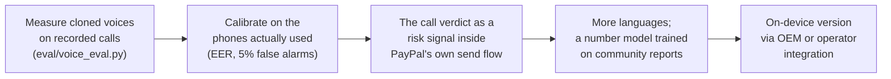

---

## 13. Project history

| When | What |
| --- | --- |
| 6–31 October 2026 | The live-call pipeline, number check, AI-voice and scam-script detection and the evidence report. Shown at **CT BuildFest 2.0** (30–31 October), where it placed 2nd. |
| November 2026, for the **PayPal AI Hackathon** | Protected Send on PayPal (Orders v2, Payments v2, webhooks, optional Payouts); the payment gate with its stricter level, audit trail and held-payment sweeper; US scam scripts and US reporting (FTC, IC3, Elder Fraud Hotline); replayed sample calls, `build_replay.py` and the hosted judge build; the 48-call evaluation and the voice evaluation script; 67 more tests (13 → 80); the MIT licence. |

Every commit after `3b7f129` is hackathon work.

---

## 14. AI used, and how

**AI inside Veracity.** All three models run on the laptop; none of them sees the payment.

| Model | What it does | Code |
| --- | --- | --- |
| [Gustking/wav2vec2-large-xlsr-deepfake-audio-classification](https://huggingface.co/Gustking/wav2vec2-large-xlsr-deepfake-audio-classification) | Scores every second of the caller's voice for how likely it is AI-generated | `app/feature/voice.py` |
| Whisper large-v3-turbo, through faster-whisper | Turns the caller's speech into text, in Hindi or English | `app/feature/transcriber.py` |
| Llama 3.1 8B, through Ollama (optional) | Reads the transcript for scam tactics the phrase rules miss. A flag is kept only if its quote is really in one transcript line | `app/feature/scam_llm.py` |

The scam rules, the risk fusion and the payment gate are plain code rather than a model, so every decision can be explained with the caller's own words.

**AI used to build it.** Claude (Anthropic) was used as a coding assistant for the work added for the PayPal AI Hackathon: the PayPal integration and payment gate, replayed calls and the judge build, the tests, the evaluation scripts, and this README. The 48 test transcripts in `eval/` were written with its help, and `eval/results.md` says so.
<!-- Before submitting: add any other AI tools used to build Veracity (for example during CT BuildFest) and what each was used for. -->

---

## 15. Tech stack and credits

| Part | Technology | Licence |
| --- | --- | --- |
| Backend | FastAPI, Pydantic v2, Uvicorn | MIT, MIT, BSD-3 |
| Dashboard | React 19, Vite 8 | MIT |
| Payments | [PayPal REST APIs](https://developer.paypal.com/api/rest/) (sandbox): Orders v2, Payments v2, Webhooks, Payouts; [httpx](https://www.python-httpx.org/) | PayPal developer terms; BSD-3 |
| PayPal button | [@paypal/react-paypal-js](https://github.com/paypal/react-paypal-js) (JavaScript SDK v6) | Apache-2.0 |
| Call audio | [scrcpy](https://github.com/Genymobile/scrcpy), [BlackHole](https://github.com/ExistentialAudio/BlackHole), sounddevice | Apache-2.0, GPL-3.0, MIT |
| AI voice | [Gustking/wav2vec2-large-xlsr-deepfake-audio-classification](https://huggingface.co/Gustking/wav2vec2-large-xlsr-deepfake-audio-classification), PyTorch, Transformers | Apache-2.0, BSD-3, Apache-2.0 |
| Speech-to-text | [faster-whisper](https://github.com/SYSTRAN/faster-whisper), Whisper large-v3-turbo | MIT |
| Local LLM | [Ollama](https://ollama.com/), Llama 3.1 8B | MIT, Llama 3.1 Community Licence |
| Phone numbers | [phonenumbers](https://github.com/daviddrysdale/python-phonenumbers) (libphonenumber) | Apache-2.0 |
| Storage | SQLite | Public domain |

**Principles we kept:**

- The call's audio never leaves the laptop. The only outside API is PayPal's, and it gets the payment, never the call.
- Money moves only when the call checks out, and the payer can always see why it's held.
- Privacy by default.
- We never quote accuracy we didn't measure ourselves.
- We say "Likely AI", never "confirmed fake".
- Every status pairs a colour with an icon and a word.

<div align="center">
<br/>
<sub>Started at CT BuildFest 2.0 · 30–31 October 2026 · Extended for the PayPal AI Hackathon · November 2026</sub>
</div>
