> [!IMPORTANT]
> **For PayPal Hackathon Judges — Run in 1 Command**
>
> From a clone of this repo, with Docker running:
>
> ```bash
> docker compose --profile judge up --build judge
> ```
>
> Then open <http://localhost:8000>. The dashboard, the models and ffmpeg are all built in, and you don't need an Android phone. **Follow the 2-minute runbook: [docs/JUDGE_TESTING.md](docs/JUDGE_TESTING.md).**

<div align="center">

# Veracity

**Hears scam calls as they happen. If the caller asks for money, PayPal holds it until the call checks out.**

[](https://youtu.be/7DbctZZKWP8?si=1eyhgEVbLM1fektF)


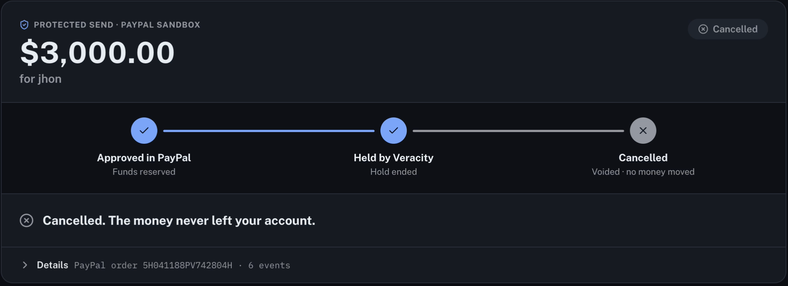

<sub>From a real phone call on 6 November 2026: a fake grandson asked for $3,000. The payer approved it in PayPal, Veracity held it, and after a callback the authorization was voided at PayPal. <a href="#tested-on-real-phone-calls">See both real-call tests</a>.</sub>

[Demo video](https://youtu.be/7DbctZZKWP8?si=1eyhgEVbLM1fektF) · [Run it](#run-it-with-docker) · [How it works](#how-it-works) · [PayPal integration](#paypal-integration) · [AI](#ai) · [Real-call tests](#tested-on-real-phone-calls) · [Results](#results-whats-measured-and-what-isnt)

</div>

---

## At a glance

| | Veracity in short |
| --- | --- |
| **What it does** | Checks the caller's number, voice and words while the call is still on. If the caller asks for money, **Protected Send** has PayPal reserve the funds instead of sending them, and the call's risk decides whether they're released or cancelled. |
| **Who it's for** | Anyone being pressured to send money during a phone call, especially older adults, and the families who look out for them. |
| **What's different** | The phone call decides what happens to the payment. A call-screening app can't see the payment and a payment check can't see the call; Veracity connects them, and either the voice or the words is enough to hold the money. |
| **PayPal** | Orders v2 with intent `AUTHORIZE`, Payments v2 capture and void, the JS SDK v6 button, verified webhooks and optional Payouts. [Every call is listed below](#paypal-integration). |
| **AI** | Spectra-0 for AI voices, Whisper for speech to text, an optional local Llama 3.1 8B for tactics the rules miss, and plain-code scam rules that quote the caller's exact words. [Details](#ai). |
| **Privacy** | Call audio, transcripts and scoring stay on your device. PayPal only sees the payment. |
| **Proof** | Two real phone calls with sandbox payments and PayPal's own API logs, a 48-call rules evaluation, a voice evaluation on about 2 hours of speech, and 164 automated tests. [Results](#results-whats-measured-and-what-isnt). |

---

## The problem

- In 2025 the FBI's IC3 counted **nearly $893 million** lost to AI-related scams, with voice clones among the tools scammers use ([FBI](https://www.fbi.gov/news/press-releases/cryptocurrency-and-ai-scams-bilk-americans-of-billions)).
- Americans aged 60 and over reported **$7.7 billion** in internet-crime losses, including **$352 million** lost to AI-related scams ([AARP on the FBI and FTC reports](https://www.aarp.org/money/scams-fraud/fbi-ftc-report-2025-losses.html)).
- The money moves **during the call**, before anyone checks. Phone apps can warn about a call and payment apps can warn about a payment, but they don't see each other.

**Who it's for.** The person on the phone being told to send money right now, especially an older adult who thinks they hear a grandchild, and the family who'd want that payment stopped. A hold costs a real family member a few minutes. A scam that gets through can cost someone their savings.

---

## How it works

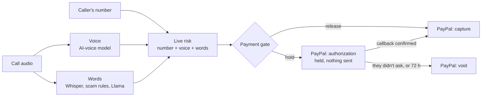

The payer approves in PayPal as usual, but the order's intent is **AUTHORIZE**: PayPal reserves the funds and nothing is sent. The payment gate then reads the call's risk at that moment ([`decide()` and `gate_level()`](veracity-backend/app/feature/payment_gate.py)), checking these rows from top to bottom:

| When PayPal authorizes, the call… | The money |
| --- | --- |
| is high risk (score ≥ 70), the voice is *Likely AI*, or the words match a known scam script (script ≥ 80) | **Held as a likely scam.** Released only if you call the person back and they confirm, and even then only after a 15-minute cooling-off |
| is still going on | **Held** until the call ends, then decided again with the final report. If the call turns high risk meanwhile, the hold becomes *likely scam* |
| is medium risk, shows some scam signs (script ≥ 40), or the caller says they're someone you know (or describes a family emergency) and asks for money | **Held until you call them back** on the number saved in your phone. "They confirmed" releases it, "they didn't ask" voids it |
| is low risk | **Released**: the authorization is captured. A payment made mid-call is released when the call ends |
| (nobody releases it within 72 hours) | **Voided** automatically, inside PayPal's 3-day honor period |

"They confirmed" can't be pressed while the call is still on, since the caller could be the one saying it. Cancelling works at any time.

### Why both the voice and the words

A scammer reading a script in their own voice gets past a voice detector. A cloned voice saying something ordinary gets past scam-word rules. Either signal is enough for Veracity to flag the call, and when neither shows up, the money goes through:

| | Scam words | Ordinary words |
| --- | --- | --- |
| **AI voice** | [ElevenLabs recording](docs/Audio/elevenlabs_scam_sample.mp3): *Likely AI*, 99%; script 100 / 100. **Held as a likely scam** | [macOS-voice clip](samples/ai-voice-normal-message.mp3): *Likely AI*, 100%; script 8 / 100. **High risk** ([measured](samples/README.md#measured-results)) |
| **Real voice** | [Real phone call](#case-1-a-fake-grandson-asks-for-3000): *Likely human*, 16%; script 92 / 100. **Held, then voided** | [Real-voice recording](docs/Audio/Real_call_no_scam.mp3): *Likely human*, 13%; script 8 / 100. **Released when the call ended** |

<sub>Voice percentages are smoothed peaks. The real phone call was scored by the voice model of the time, since replaced by Spectra-0, which scored the other three.</sub>

---

## Run it with Docker

There's no hosted demo: call audio, transcripts and scoring stay on your own machine, so Veracity runs there, with the real models, from one command. **[docs/JUDGE_TESTING.md](docs/JUDGE_TESTING.md) has the exact clicks and the API call behind each step.**

You need [Docker Desktop](https://www.docker.com/products/docker-desktop/) (or Docker Engine with Compose 2.24 or newer) on amd64 or arm64, at least **6 GB of memory** for Docker (Docker Desktop → Settings → Resources) and about **10 GB of free disk**.

```bash
git clone https://github.com/YADUNANDAN-SINGH/Veracity.git && cd Veracity
cp .env.example .env    # optional: add PAYPAL_CLIENT_ID and PAYPAL_CLIENT_SECRET from a sandbox app
docker compose --profile judge up --build judge
```

Then open <http://localhost:8000>.

- **How long it takes:** the first build took 8 to 12 minutes on an Apple M5, and later starts are ready in under 30 seconds. A slower connection or CPU takes longer. The models are baked into the image, and the build's last step runs them with the network off, so nothing is downloaded at run time.
- **PayPal:** with sandbox keys in `.env` ([docs/PAYPAL_SETUP.md](docs/PAYPAL_SETUP.md), steps 1 and 2), Protected Send uses the real PayPal sandbox. Without them, a built-in in-memory stand-in answers the same API calls, clearly labelled as not PayPal. `.env` is git-ignored.
- **Name the `judge` service** as shown: without it, Compose also starts the other services in the file.

### What to test

To pay in **Protected Send**, use the PayPal button as a sandbox buyer (the login is in the Devpost testing instructions) or, without keys, **Approve with the PayPal stand-in**.

| Test | Do this | What you should see | PayPal |
| --- | --- | --- | --- |
| **1. A scam call** | **Pick a sample call** → **"Grandma, it's me": a grandparent scam** → **Start the call** → pay → **End call & build report** → **Jake didn't ask: cancel** | **Held**, quoting the caller's own words with timestamps, then *"Cancelled. The money never left your account."* **Details** shows each API call with its HTTP status and `debug_id` | `AUTHORIZE`, then **void** |
| **2. A legitimate call** | **See report** → **Check another call** → **A real grandson asking for $50 for a birthday cake** → **Start the call** → pay → **End call & build report** | **Held** while the call is on, then released automatically with no callback: *"Released to Jake (grandson)."* | `AUTHORIZE`, then **capture** |
| **3. A cloned AI voice, then a real one** | On the first screen, **Replay ElevenLabs AI Scam Audio**, then **Replay Real Voice (No Scam)** | The AI voice turns *Likely AI* at 0:05 and holds its 99% peak, with a script score of 100 / 100. The real voice stays *Likely human*, peaking at 13%, with a script score of 8 / 100 | Optional |

**The two recordings.** [`elevenlabs_scam_sample.mp3`](docs/Audio/elevenlabs_scam_sample.mp3) is a scam call in an emotional voice we generated with [ElevenLabs](https://elevenlabs.io/) (44 s). [`Real_call_no_scam.mp3`](docs/Audio/Real_call_no_scam.mp3) is a real person asking for $50 for gas (66 s).

**To run the models live,** select **Upload a call recording** and choose one of those files or your own (wav, mp3, m4a, ogg, flac or webm; up to 2 minutes and 20 MB; [`samples/`](samples/) has more clips). It plays through the same pipeline as a live call. When the screen says **Recording finished**, select **End call & build report** → **See report** → **Download JSON** for the evidence file. Upload the audio file itself: a clip played from a speaker across a room is the hardest case for the voice model.

**Uploads run on your CPU.** Docker has no GPU, and the voice model scores 4 seconds of audio every second. On an Apple M5, the two built-in recordings reached their reports in about 1 minute and 70 seconds; a 60-second recording took 2.0 to 2.4 minutes in earlier runs. A slower laptop takes longer, but the results are the same: nothing is skipped.

**What's real in each test:**

| | Scripted sample calls | Recorded sample calls | Uploads |
| --- | --- | --- | --- |
| **Scam rules, risk fusion, payment gate** | Live | Live | Live |
| **Voice score** | None, and none is invented: there's no audio | Spectra-0's real output on the file, computed ahead of time, with the file's SHA-256 | Spectra-0, live on your CPU |
| **Transcript** | Written by hand | Whisper's real output on the file, computed ahead of time | Whisper *small*, live on your CPU |

Docker has no local LLM, so the scam rules run alone, and the report says so (`llm_used: false`). Live phone capture (scrcpy and BlackHole on a real call) is what the [video](https://youtu.be/7DbctZZKWP8?si=1eyhgEVbLM1fektF) and the [real-call tests](#tested-on-real-phone-calls) show.

<details>
<summary><b>Test it deeper:</b> a real phone call, with the full setup and no Docker</summary>

<br/>

To judge Veracity the way it's meant to run, on a **real phone call** as it happens, follow [The phone build (Mac + Android)](#the-phone-build-mac--android). Compared with Docker it adds:

- **A live call**: the caller's voice is captured from an Android phone over USB (scrcpy and BlackHole), and the meters, transcript and red flags update while you're still talking.
- **The bigger models**: Whisper large-v3-turbo instead of *small*, Spectra-0 on the Mac's GPU when PyTorch can use it, and the local LLM (Llama 3.1 8B through Ollama) reading the transcript for tactics the rules miss.
- **More ways to test**: Hindi and Hinglish calls (`VERA_LANGUAGE=hi`), *Save call audio* with a SHA-256 in the report, and the number filled in from the ringing phone.
- **The same PayPal sandbox flow**: Protected Send during the call, held, then released or voided.

| | **Docker** | **The full setup** |
| --- | --- | --- |
| Computer | macOS, Windows or Linux; amd64 or arm64 | A Mac with Apple Silicon |
| Software | [Docker Desktop](https://www.docker.com/products/docker-desktop/) (or Docker Engine with Compose 2.24 or newer), git | git, [Homebrew](https://brew.sh/), Python 3.12 or 3.13, Node.js 22, adb, scrcpy 3.2 or newer, BlackHole 2ch; [Ollama](https://ollama.com/) is optional |
| Hardware | At least 6 GB of memory for Docker, about 10 GB of free disk | An Android phone with USB debugging on, a USB data cable, and a second phone to call it from |
| Downloads | The image is 6.2 GB once built; the models are baked in | Spectra-0 (1.3 GB), Whisper large-v3-turbo (1.5 GB), and Llama 3.1 8B (4.9 GB) if you use the LLM |

No Android phone? The same backend replays the sample calls without one (`VERA_FAKE=1`; see the phone build section).

</details>

---

## PayPal integration

Every PayPal call Veracity makes, all against the **sandbox** (`api-m.sandbox.paypal.com`; there's no live switch):

| When | PayPal call | Why |
| --- | --- | --- |
| Before any other call | `POST /v1/oauth2/token` | Client-credentials token, cached until a minute before it expires |
| The user starts a Protected Send | `POST /v2/checkout/orders` with intent `AUTHORIZE` | The payer approves as usual, but approving moves no money |
| The payer approves in the PayPal button | `POST /v2/checkout/orders/{id}/authorize` | Reserves the funds; the gate then decides with the call's risk |
| The call checks out, a callback is confirmed, or a cooling-off ends | `POST /v2/payments/authorizations/{id}/capture` | **Release** |
| The payer cancels, a callback is denied, or 72 hours pass | `POST /v2/payments/authorizations/{id}/void` | **Cancel**: the money never leaves the payer |
| A capture or void fails | `GET /v2/payments/authorizations/{id}` | Record PayPal's real state instead of guessing; a capture that failed when the call ended is retried |
| PayPal sends a webhook (optional, `PAYPAL_WEBHOOK_ID`) | `POST /v1/notifications/verify-webhook-signature` | Only events PayPal signed change a payment; each event id is applied once |
| After a release (optional, `PAYPAL_PAYOUTS=1`) | `POST /v1/payments/payouts` | Forward the money to the recipient's PayPal email |

- **Button:** the payer approves in PayPal's own pop-up, through the JavaScript SDK v6 `PayPalOneTimePaymentButton` from `@paypal/react-paypal-js/sdk-v6` ([`ProtectedSend.jsx`](veracity-frontend/veracity/src/components/payment/ProtectedSend.jsx)).
- **Idempotency:** every request that creates, authorizes, captures, voids or pays out carries a `PayPal-Request-Id`, so a retried request can't do it twice.
- **If PayPal fails when a call ends:** the report still comes back and the money stays held. The card says *Held · waiting for PayPal*, and Veracity retries the capture by itself with growing waits, under the same `PayPal-Request-Id`, until it succeeds or the hold runs out.
- **Audit trail:** each PayPal answer (method, path, HTTP status, `paypal-debug-id`, time) is stored with the payment and shown under **Details** on the card.
- **Code:** [`paypal_client.py`](veracity-backend/app/feature/paypal_client.py) (the REST calls), [`payment_gate.py`](veracity-backend/app/feature/payment_gate.py) (the decisions). Setup, webhooks and Payouts: [docs/PAYPAL_SETUP.md](docs/PAYPAL_SETUP.md).

The scam path, start to finish:

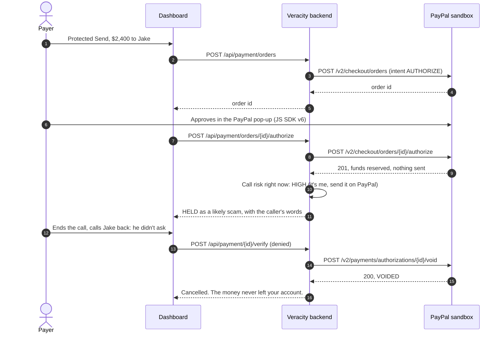

**What this is, honestly.** The payer pays through Veracity's own Protected Send checkout, because a third-party app can't pause a payment made inside the PayPal app. Veracity adds the one thing a payment system can't see: the phone call.

---

## AI

| Model | Job | Where it runs |
| --- | --- | --- |
| [Spectra-0](https://huggingface.co/lab260/spectra_0), an XLS-R anti-spoofing network | Scores the last 4 s of the caller's voice every second for how likely it is AI-generated; three windows in a row are needed for *Likely AI*, and the call then stays flagged | Phone build, on the laptop; the Docker judge build, on uploads |
| Whisper large-v3-turbo, through [faster-whisper](https://github.com/SYSTRAN/faster-whisper) | Transcribes the caller at each pause, in Hindi or English | Phone build, on the laptop; the Docker judge build uses *small*, on uploads |
| Llama 3.1 8B, through [Ollama](https://ollama.com/) (optional) | Reads the transcript for scam tactics the rules miss; a flag is kept only if its quote is really in one transcript line | Phone build, on the laptop |
| Scam rules (plain code, 12 categories) | Flags scam phrases in English, Hinglish and Hindi with the exact words and time, and scores the script 0 to 100 | Every build |
| Risk fusion and the payment gate (plain code) | Number 25%, voice 40%, script 35%; one strong signal is enough on its own | Every build |

**Where the models run.** The phone build runs all three on a live call. The Docker judge build runs Spectra-0 and Whisper on an uploaded recording, without the LLM. Sample calls load no model: they go through the same scam rules, risk fusion and payment gate. A scripted one has no audio, so its held card says "Voice not scored on this call"; the two recorded ones replay Spectra-0's and Whisper's real output on their recordings. The dashboard's first screen lists what is real in the build it runs on.

**AI voices, measured.** On 7 November the tester played the demo video's narration, speech generated by Google Veo, into a call, and the first voice model said *Likely human* throughout. It missed most current generators, and the live pipeline was also resampling the call block by block, which put a click every 0.1 s into what the model heard. Both are fixed. Measured as recorded and through simulated narrowband and wideband calls:

| Measured on | First model | Spectra-0 |
| --- | --- | --- |
| **AI calls turned *Likely AI*** (40 minutes: Veo, ElevenLabs, an AI podcast, macOS voices) | 39% | **85%** |
| **Real people's calls wrongly turned *Likely AI*** (81 minutes: phone calls in six locales, read Hindi, Tamil and English, audiobooks) | Up to 60% of the audiobooks | **1.1%** |

The 2-minute demo narration now turns *Likely AI* 16–75 s into the call. **The hard case is a clip played from a speaker across a room**: the reverberation hides it, and only 19% of AI calls are caught that way. Everything, with the limits: [`eval/voice_results.md`](eval/voice_results.md).


<sub>Veracity also reads Hindi and Hinglish scripts (<code>VERA_LANGUAGE=hi</code>). A real test call on 31 October 2026, before the UI refresh: a person read a Hindi "digital arrest" script, the voice stayed <i>Likely human</i>, and the rules caught the script word for word. The number is blurred.</sub>

---

## Tested on real phone calls

On 6 November 2026 we ran the **phone build** end to end on two real calls: an Android phone over USB, the caller's audio captured with scrcpy and BlackHole, the AI-voice model and Whisper running on the laptop, and a real payment in the **PayPal sandbox** each time (`VERA_REGION=US`, `VERA_LANGUAGE=en`).

The same tester made both calls from the same phone, so the number and the voice were the same. **Only the words were different, and the money went the right way both times.** Phone numbers are blurred in every screenshot.

| | Case 1: fake grandson, $3,000 | Case 2: real grandson, $50 |
| --- | --- | --- |
| What the caller said | A car crash, a police fine, a lawyer's fee, "do not tell anyone", "Do not disconnect" | Mom's birthday cake, "No rush… $50 only" |
| Script | **92 / 100**: 6 red flags in 4 categories | **8 / 100**: 1 mild flag ("right now") |
| Voice | *Likely human* (smoothed peak 16%) | *Likely human* (smoothed peak 15%) |
| Number | An Indian mobile: international, +25 | The same number, +25 |
| Call risk | **92 / 100, high** | **15 / 100, low** |
| The money | Held, then **voided** after the callback | Held during the call, **captured** when it ended |
| PayPal sandbox | create **200** → authorize **201** → void **200** | create **200** → authorize **201** → capture **201** |

### Case 1: a fake grandson asks for $3,000

The tester played the scammer and read a "grandson in trouble" script in English: he'd crashed his car, the police wanted a $2,000 fine "right now", his lawyer wanted $1,000 more, and nobody must know. While the call was still on, the payer sent $3,000 to "jhon" with Protected Send.

| When | What Veracity did | PayPal sandbox |
| --- | --- | --- |
| During the call | The payer approved $3,000 in PayPal. Veracity **held** it because the call was still going; the words already showed scam signs (script 48 / 100), so the card marked it *medium risk for a payment* | `POST /v2/checkout/orders` **200**<br/>`POST /v2/checkout/orders/{id}/authorize` **201** |
| When the call ended | "send me $3,000" and "Do not disconnect" came in. The script reached **92 / 100**, with authority and payment pressure in the same call, and the hold became a *likely scam* hold | Nothing: the money stays authorized, not sent |
| After the callback | The real grandson hadn't asked, so the payer chose **jhon didn't ask: cancel**: *"Cancelled. The money never left your account."* | `POST /v2/payments/authorizations/{id}/void` **200** |

<table>
  <tr>
    <td width="50%">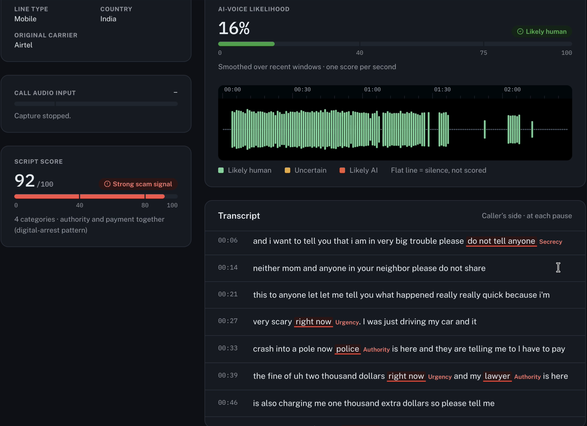</td>
    <td width="50%">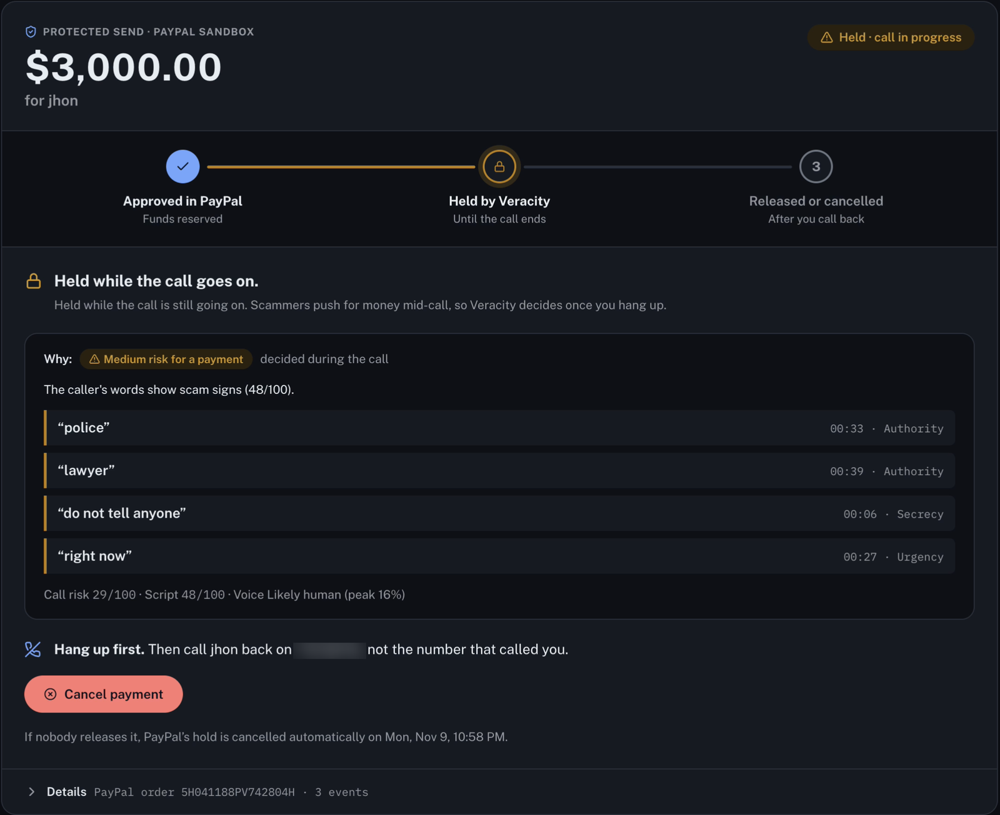</td>
  </tr>
  <tr>
    <td><sub><b>1.</b> What Veracity heard. The caller's side is transcribed at each pause and the red flags are marked in place. The voice stayed <i>Likely human</i>: a real person was reading the script.</sub></td>
    <td><sub><b>2.</b> The payer pays mid-call. PayPal authorizes the $3,000 and Veracity holds it until the call ends, quoting the caller's words.</sub></td>
  </tr>
  <tr>
    <td>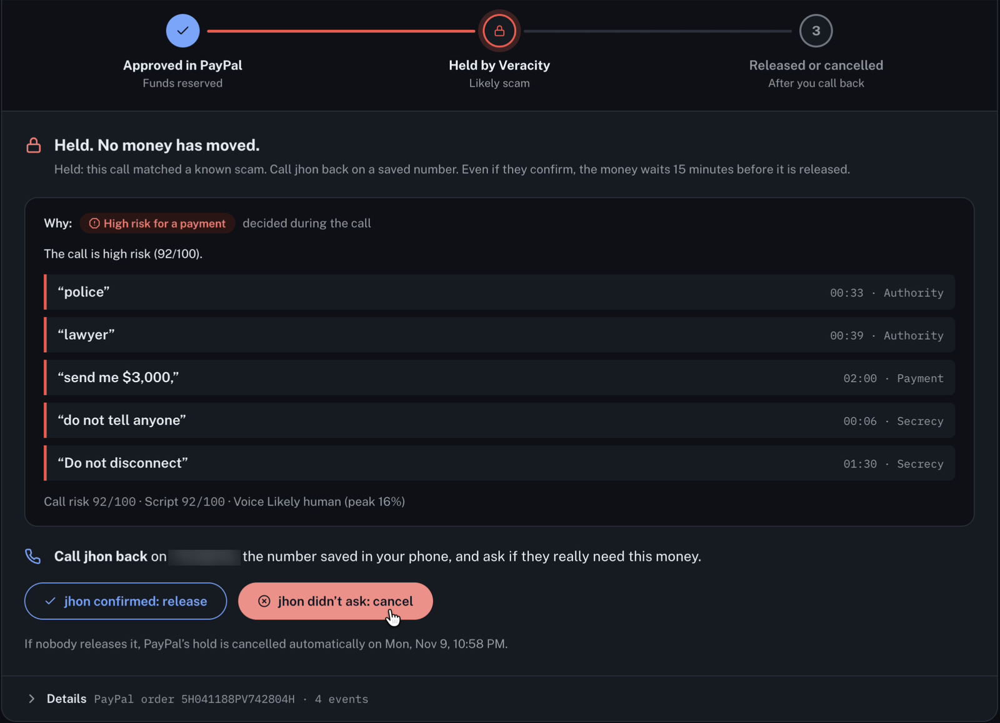</td>
    <td>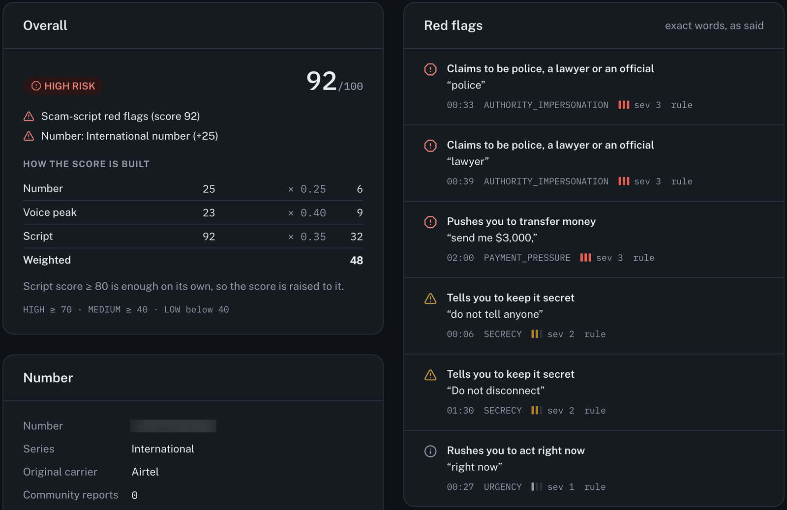</td>
  </tr>
  <tr>
    <td><sub><b>3.</b> The call ends at 92 / 100. The hold becomes a likely-scam hold, and the payer is asked to call the person back on their saved number before anything is released.</sub></td>
    <td><sub><b>4.</b> The evidence report: every score with its reason, and every red flag with the caller's exact words and the time they were said.</sub></td>
  </tr>
</table>

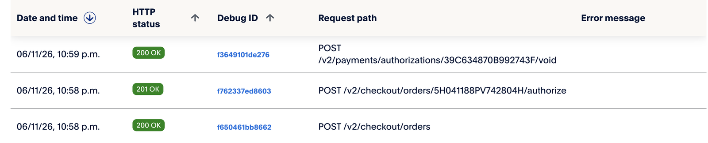

<sub>PayPal's own record, from the sandbox API Calls log on developer.paypal.com: create the order (200), authorize it (201), void the authorization (200). Order <code>5H041188PV742804H</code> is the one under <b>Details</b> on Veracity's card.</sub>

<details>
<summary><b>All the evidence for this call</b>: the report, the voice verdict and report.json</summary>

<br/>

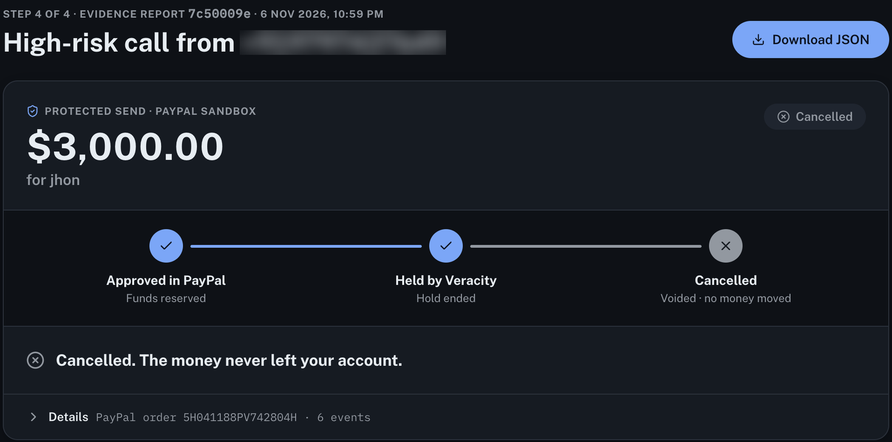

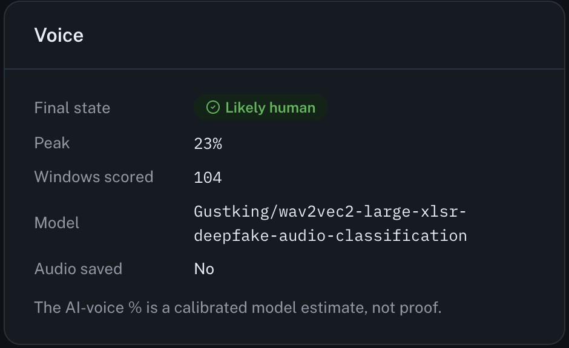

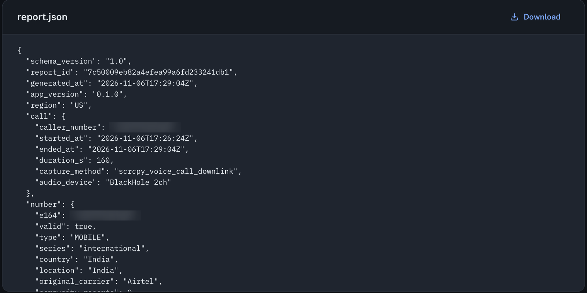

</details>

### Case 2: the real grandson asks for $50

The same tester called again as the real grandson: it was Mom's birthday, he was in the queue buying her a cake and was short on money. "So can you please send me $50 really quick? No rush… $50 only." The payer sent $50 with Protected Send during the call.

| When | What Veracity did | PayPal sandbox |
| --- | --- | --- |
| During the call | The payer approved $50. Veracity **held** it because the call was still going, as it does with every payment made mid-call | `POST /v2/checkout/orders` **200**<br/>`POST /v2/checkout/orders/{id}/authorize` **201** |
| When the call ended | Still low risk, **15 / 100**: one mild flag, no police, lawyer, secrecy or fee, and a *Likely human* voice. Veracity **released** the money with no callback needed | `POST /v2/payments/authorizations/{id}/capture` **201** |

An international number on its own adds 25 points, which isn't enough to hold money. This is the false alarm Veracity has to avoid: a real family member asking for money shouldn't be stopped.

<table>
  <tr>
    <td width="50%">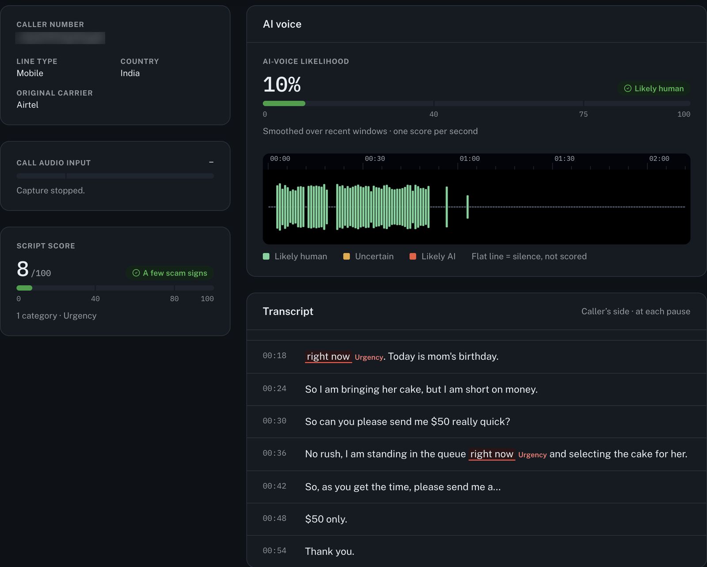</td>
    <td width="50%">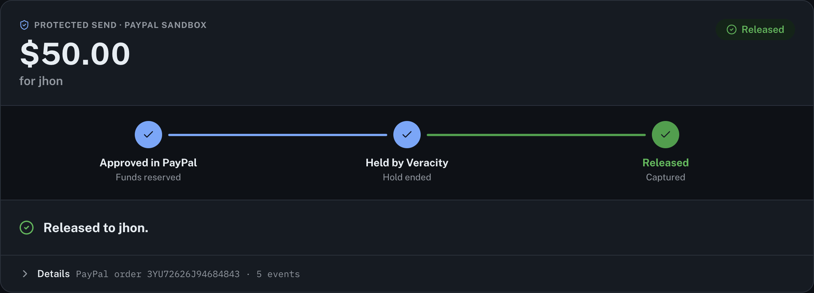<br/><br/>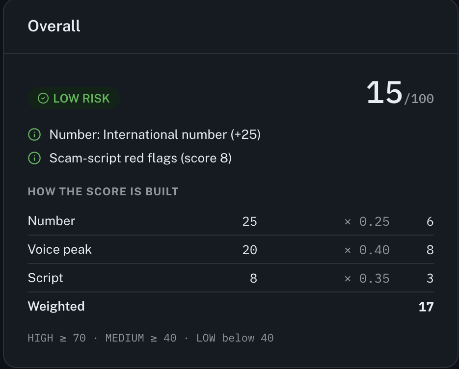</td>
  </tr>
  <tr>
    <td><sub><b>1.</b> What Veracity heard: a birthday cake and "No rush". Script 8 / 100, voice <i>Likely human</i>.</sub></td>
    <td><sub><b>2.</b> The call ended low risk (15 / 100), so PayPal captured the $50: <i>"Released to jhon."</i></sub></td>
  </tr>
</table>

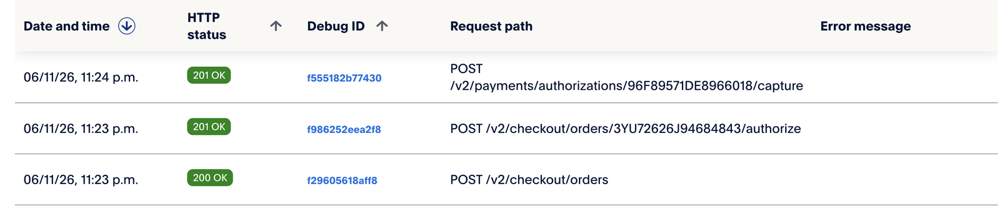

<sub>PayPal's record of this payment: create the order (200), authorize it (201), capture the authorization (201). Order <code>3YU72626J94684843</code> is the one under <b>Details</b> on Veracity's card.</sub>

<details>
<summary><b>All the evidence for this call</b>: the report, the voice verdict and report.json</summary>

<br/>

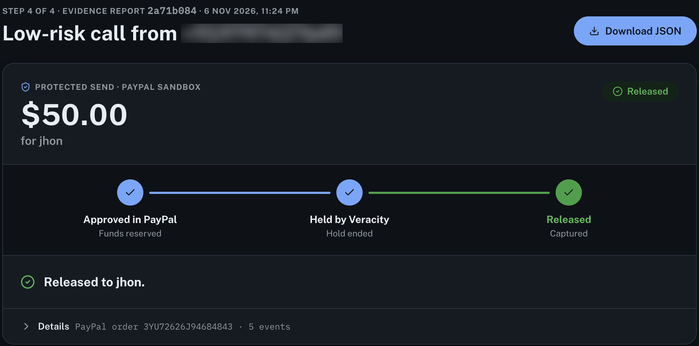


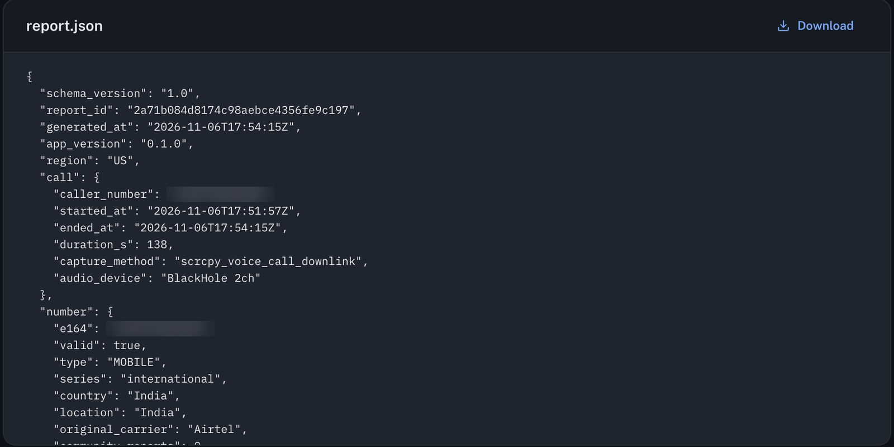

</details>

<sub>About the voice numbers: the payment card shows the smoothed voice score that the risk score uses. The report's Voice card and its <i>How the score is built</i> table show the highest single 4-second window (23% and 20% on these calls), which is why that table can add up to slightly more than the final score. These two calls were scored by the voice model of the time, a wav2vec2 classifier, since replaced: see [AI](#ai).</sub>

---

## Results: what's measured and what isn't

| What | Result | Source |
| --- | --- | --- |
| Real phone calls with PayPal payments (6 Nov 2026) | Fake grandson, $3,000: **92 / 100**, held, then voided (authorize **201** → void **200**).<br/>Real grandson, $50: **15 / 100**, captured when the call ended (authorize **201** → capture **201**). | [Tested on real phone calls](#tested-on-real-phone-calls), with PayPal's API Calls logs |
| The two built-in recordings, through the Docker judge build (9 Nov 2026) | ElevenLabs AI voice: *Likely AI* from 0:05, **99%** peak, script **100 / 100**, high risk.<br/>Real person: *Likely human*, **13%** peak, script **8 / 100**, low risk.<br/>The live models and the replay's computed scores agree. | [`elevenlabs_scam_us.json`](veracity-backend/app/scenarios/elevenlabs_scam_us.json), [`real_voice_no_scam_us.json`](veracity-backend/app/scenarios/real_voice_no_scam_us.json) |
| Real phone call in Hindi (31 Oct 2026) | "Digital arrest" script read by a person: voice *Likely human*, script **82 / 100**, scam alert fired | The screenshot in [AI](#ai) |
| Scam rules on 48 written test calls (24 scam, 24 ordinary) | Live alert (script ≥ 80): **6 / 24** scams, **0 / 24** ordinary calls.<br/>Some scam signs (script ≥ 40), which hold a payment: **21 / 24** scams, **0 / 24** ordinary calls. | [`eval/results.md`](eval/results.md), from `python eval/run_rules_eval.py` |
| Automated tests | **164 passing**, with no phone, models or PayPal account (PayPal is replaced by [`paypal_standin.py`](veracity-backend/app/feature/paypal_standin.py), through [`tests/fake_paypal.py`](veracity-backend/tests/fake_paypal.py)) | `cd veracity-backend && python -m pytest -q` |
| Docker judge build, uploads on an Apple M5 (10 CPUs, 7.7 GB for Docker, no GPU) | Recordings of 44 s and 66 s reached their reports in about **1 min** and **70 s** (9 Nov); a 60 s recording in **2.0 to 2.4 min** (3 runs, 8 Nov); first build **8 min 27 s to 11 min 24 s**; image **6.2 GB**; memory **4.4 GB** at its highest during an upload | Measured on 8 and 9 November 2026 |
| AI-voice model on 40 min of AI speech and 81 min of real people, through simulated calls | **85%** of AI calls turned *Likely AI*, **1.1%** of real people's calls; a clip played from a speaker across a room: **19%** | [`eval/voice_results.md`](eval/voice_results.md), measured with [`eval/voice_eval.py`](eval/voice_eval.py)'s channels |

**About the 48 test calls:** they are short transcripts **written for this test, with AI help**, not recordings. They cover US English, Indian English, Hinglish and Hindi, and include ordinary calls that use the same words as scams (a real bank's fraud check, a delivery driver, a friend asking for $20). The rules were tuned on similar phrasing, so real-world recall will be lower, and on a live call Whisper's mistakes come first.

---

## What's new for this hackathon

| Started at CT BuildFest 2.0 (30–31 October 2026) | Built for the PayPal AI Hackathon |
| --- | --- |
| A live-call detector: Android over USB, scrcpy and BlackHole | **Protected Send**: Orders v2 (intent AUTHORIZE), Payments v2 capture and void, verified webhooks, optional Payouts, the JS SDK v6 button |
| Number check, the AI-voice model, Whisper, 11 scam-rule categories (Indian scripts), the local LLM | **The payment gate**: hold rules, callbacks, cooling-off, escalation, 72-hour auto-void, reconciling with PayPal, audit trail |
| The JSON evidence report | US scam scripts and the "it's me" identity claim (12th category); US reporting (FTC, IC3, Elder Fraud Hotline) |
| 13 tests | Replayed sample calls and the light build (`Dockerfile`); the Docker judge build with uploaded recordings and two built-in recordings (`Dockerfile.judge`); the PayPal stand-in and automatic retries when PayPal fails at hang-up; the 48-call evaluation and `voice_eval.py`; the AI-voice evaluation; 164 tests; the MIT license; the redesigned payment card |

Everything PayPal was built for this hackathon. Every commit after `3b7f1298` (31 October 2026) is hackathon work.

---

## Run it yourself

### The Docker judge build (uploads, the real models)

See [Run it with Docker](#run-it-with-docker): `docker compose --profile judge up --build judge`. It's [`Dockerfile.judge`](Dockerfile.judge).

### The light build (sample calls only, no models)

A small image with no models: sample calls and Protected Send, no uploads. With Docker:

```bash
git clone https://github.com/YADUNANDAN-SINGH/Veracity.git && cd Veracity
docker build -t veracity .
docker run --rm -p 8000:8000 veracity
# Protected Send needs PayPal sandbox keys (docs/PAYPAL_SETUP.md):
docker run --rm -p 8000:8000 -e PAYPAL_CLIENT_ID=... -e PAYPAL_CLIENT_SECRET=... veracity
```

Without Docker (Python 3.12 and Node.js 22, as in the Dockerfile):

```bash
(cd veracity-frontend/veracity && npm ci && npm run build)
cd veracity-backend && python3 -m venv venv && source venv/bin/activate
pip install -r requirements-judge.txt
cp .env.example .env    # PayPal sandbox keys go here (docs/PAYPAL_SETUP.md); empty is fine
VERA_MODE=judge VERA_REGION=US VERA_STATIC_DIR=../veracity-frontend/veracity/dist \
  uvicorn main:app --port 8000 --env-file .env
```

Open <http://localhost:8000>.

### The phone build (Mac + Android)

You need macOS on Apple Silicon, Python 3.12 or 3.13, Node.js 22, and an Android phone with USB debugging on. [Ollama](https://ollama.com/) is optional.

```bash
brew install --cask android-platform-tools   # adb
brew install scrcpy blackhole-2ch            # scrcpy 3.2 or newer

cd veracity-backend
python3 -m venv venv && source venv/bin/activate
pip install -r requirements.txt -r requirements-ml.txt

# Download the models once; after this the call analysis works offline
hf download lab260/spectra_0 model.safetensors --revision b3fb6d5c9d8ce069996f100cbe10117fd74165f3
python -c "from faster_whisper import WhisperModel; WhisperModel('large-v3-turbo', device='cpu', compute_type='int8')"
ollama pull llama3.1:8b                      # optional

cp .env.example .env                         # PayPal sandbox values: docs/PAYPAL_SETUP.md
echo "VERA_LANGUAGE=en" >> .env              # English calls (the default, hi, is for Hindi)
uvicorn main:app --reload --port 8000 --env-file .env
```

In a second terminal, `cd veracity-frontend/veracity && npm install && npm run dev`, then open <http://localhost:5173>. Vite forwards `/api` and `/ws` to the backend. No phone handy? Start the backend with `VERA_FAKE=1 uvicorn …` to replay the sample calls.

<details>
<summary><b>Connecting the phone</b>: USB debugging, call audio, BlackHole</summary>

<br/>

1. **USB debugging.** Settings → About phone, tap *Build number* 7 times (on Xiaomi, *MIUI version*). In Developer options turn on *USB debugging* (on Xiaomi also *USB debugging (Security settings)*). Plug in with a data cable and accept the prompt; `adb devices` must list the phone as `device`.
2. **Route the call into BlackHole.** scrcpy plays the caller through the Mac's current sound output. In **Audio MIDI Setup**, create a **Multi-Output Device** with your speakers or headphones first, then **BlackHole 2ch** (Drift Correction on BlackHole only), and make it the sound output. Allow Microphone access for the terminal when macOS asks, or BlackHole records silence.
3. **Check the phone shares call audio.** During a real call:

   ```bash
   scrcpy --no-video --no-playback --require-audio --audio-source=voice-call-downlink \
     --audio-codec=aac --record=downlink_test.m4a --time-limit=20
   ```

   If `downlink_test.m4a` is silent, retry with `--audio-source=voice-call` and run the backend with `VERA_AUDIO_SOURCE=voice-call`.
4. **Monitor a call.** Step 1 should be all green. Step 2 fills in the number when the phone rings. Step 3 starts scrcpy and listens; send any money from its **Protected Send** panel. Then **End call & build report**.

Android doesn't let ordinary apps record calls. scrcpy runs its capture code on the phone through `adb`, and since v3.2 it can capture the caller's side of a call. A product would need OEM or operator integration; the cable proves the pipeline end to end.

</details>

<details>
<summary><b>Configuration</b>: environment variables</summary>

<br/>

| Variable | Default | What it does |
| --- | --- | --- |
| `PAYPAL_CLIENT_ID`, `PAYPAL_CLIENT_SECRET` | unset | PayPal **sandbox** REST app; without them Protected Send says it isn't set up, or uses the stand-in with `VERA_PAYPAL_STANDIN=1` |
| `VERA_PAYPAL_STANDIN` | unset (`1` in the Docker judge build) | `1`: with no sandbox keys, an in-memory stand-in answers PayPal's API calls, labelled as not PayPal. Keys always win |
| `PAYPAL_WEBHOOK_ID` | unset | Turns on `/api/paypal/webhook` and its signature check |
| `PAYPAL_PAYOUTS` | `0` | `1`: after a release, forward the money to the recipient's PayPal email |
| `VERA_SANDBOX_BUYER_EMAIL`, `VERA_SANDBOX_BUYER_PASSWORD` | unset | A **sandbox** test buyer the judge builds show on their first screen |
| `VERA_MODE` | unset | `judge`: the Docker builds. Replays sample calls and skips hardware checks; loads the models only with `VERA_UPLOAD=1` |
| `VERA_UPLOAD` | unset (`1` in `Dockerfile.judge`) | `1`: accept uploaded recordings, if torch, faster-whisper and ffmpeg are installed |
| `VERA_UPLOAD_SPEED` | `1` | `2` plays an uploaded recording twice as fast (the models may not keep up) |
| `VERA_UPLOAD_MAX_MB`, `VERA_UPLOAD_MAX_S` | `20`, `120` | The largest upload, and the longest recording in seconds |
| `VERA_REGION` | `IN` | `US` or `IN`: how numbers are read, and which reporting links the report gives |
| `VERA_FAKE` | unset | `1`: no phone needed; Step 3 replays a sample call |
| `VERA_SCENARIO` | `grandparent_us` (US) or `digital_arrest_in` (IN) | The sample call a replay starts with |
| `VERA_REPLAY_SPEED` | `1` | `2` replays a call twice as fast |
| `VERA_STATIC_DIR` | unset | A built dashboard (`dist/`) for the backend to serve |
| `VERA_SAMPLE_AUDIO_DIR` | `docs/Audio` (`/app/sample_audio` in the judge images) | Where a recorded sample call's audio file is |
| `VERA_DB` | `app/data/veracity.db` | SQLite file for reports, community reports and payments |
| `VERA_CURRENCY` | `USD` | Protected Send's default currency (USD, GBP, EUR, CAD or AUD) |
| `VERA_HOLD_HOURS` | `72` | A hold nobody releases is voided after this long; 72 at most |
| `VERA_COOL_OFF_MIN` | `15` | How long a likely-scam payment still waits after a confirmed callback |
| `VERA_AUDIO_DEVICE` | `BlackHole 2ch` | Input device to record from |
| `VERA_AUDIO_SOURCE` | `voice-call-downlink` | scrcpy audio source; `voice-call` mixes both sides |
| `VERA_VOICE_MODEL` | `lab260/spectra_0` | Model for the AI-voice score; any Hugging Face audio-classification model also works |
| `VERA_VOICE_T`, `VERA_T_AI`, `VERA_T_UNCERTAIN` | `1.0`, `0.75`, `0.40` | Calibration temperature, and the *Likely AI* and *Uncertain* thresholds |
| `VERA_WHISPER_MODEL`, `VERA_WHISPER_THREADS` | `large-v3-turbo` (`small` in `Dockerfile.judge`), up to 8 | Whisper size (use `small` on a slower Mac) and CPU threads. The Docker judge build gives Whisper about two thirds of the CPUs and torch (`OMP_NUM_THREADS`) the rest; another size there also needs `HF_HUB_OFFLINE=0` to download it |
| `VERA_LANGUAGE` | `hi` | `hi`, `en`, or `auto` |
| `VERA_LLM_MODEL`, `OLLAMA_HOST` | `llama3.1:8b`, `http://localhost:11434` | The local LLM |

</details>

<details>
<summary><b>API</b>: REST endpoints and the WebSocket</summary>

<br/>

| Method | Path | Purpose |
| --- | --- | --- |
| GET | `/api/health` | Backend, phone and model status; mode, region and PayPal setup |
| GET | `/api/call/state` | Ringing, in call, and the caller's number, read over adb |
| POST | `/api/number/check` | A number's facts, series, community reports and rule score |
| POST | `/api/number/report` | Save a community report |
| GET | `/api/session/scenarios` | The sample calls that can be replayed |
| GET | `/api/session/scenarios/{id}/audio` | A recorded sample call's audio file, played along with its replay |
| POST | `/api/session/start` | Start monitoring (or replaying) a call |
| POST | `/api/session/upload` | Multipart `file` (and `caller_number`): analyse a recording like a live call. 503 without the models, 409 while another upload runs |
| POST | `/api/session/{id}/say` | A replayed call hears this as the caller's next words |
| GET | `/api/session/{id}/risk` | The call's risk so far |
| POST | `/api/session/{id}/stop` | End the call, decide payments that waited for it, save the report |
| GET | `/api/report/{id}` | A saved report, with its payments as they are now; `?download=1` sends it as a file |
| WS | `/ws/live/{id}` | Live events: mode, level, voice, transcript, flag, script, alert, audio_done, report |
| GET | `/api/payment/config` | Whether PayPal is set up, the sandbox client id, currencies, hold policy |
| POST | `/api/payment/orders` | Create the PayPal order (intent AUTHORIZE) |
| POST | `/api/payment/orders/{order_id}/standin-approve` | The in-memory stand-in only: what a payer does in PayPal's pop-up |
| POST | `/api/payment/orders/{order_id}/authorize` | After the payer approves: authorize, then hold or release |
| GET | `/api/payment?session_id=` | A call's payments, each with its policy and audit trail |
| GET | `/api/payment/{id}` | One payment, brought up to date |
| POST | `/api/payment/{id}/verify` | `{outcome: "confirmed" \| "denied"}` after the callback |
| POST | `/api/payment/{id}/cancel` | Void the authorization |
| POST | `/api/paypal/webhook` | PayPal webhooks, signature checked before anything changes |

Interactive docs are at <http://localhost:8000/docs> while the backend runs.

</details>

<details>
<summary><b>Troubleshooting</b></summary>

<br/>

| Problem | Fix |
| --- | --- |
| Protected Send says PayPal isn't set up | Set `PAYPAL_CLIENT_ID` and `PAYPAL_CLIENT_SECRET` from a **sandbox** app, and start the backend with `--env-file .env` |
| Protected Send says *PayPal stand-in* | The Docker judge build found no sandbox keys. Put them in `.env` and run `docker compose --profile judge up --build judge` again for the real sandbox |
| The PayPal button doesn't appear | The browser couldn't load PayPal's SDK: check for an ad blocker, and that the client id is the sandbox one |
| The PayPal pop-up won't take your login | Use a sandbox **personal** test account, not a real PayPal login |
| A payment says *Held · waiting for PayPal* | The call checked out but PayPal didn't complete the capture. No money has moved, and Veracity retries by itself; the card shows when |
| A payment stays *Held* | That's the gate working: end the call, call the person back, then choose *confirmed* or *didn't ask* |
| Webhooks return 400 | `PAYPAL_WEBHOOK_ID` must be the id of the webhook PayPal is sending to; the webhook simulator's events can't be verified, so test with a real sandbox payment |
| **No call audio** banner, flat waveform | The Mac's sound output doesn't include BlackHole: set up the Multi-Output Device |
| **No phone found** | Run `adb devices`; replug, set USB mode to *File transfer*, accept the debugging prompt |
| Transcript in the wrong language, or lagging | Set `VERA_LANGUAGE`; on a slower Mac use `VERA_WHISPER_MODEL=small` |
| No *local LLM* flags | Start Ollama and `ollama pull llama3.1:8b`; the rules work without it |
| `address already in use`, or Docker says port 8000 is allocated | Another copy is running on port 8000: stop it (`docker compose --profile judge down`, or `lsof -nP -iTCP:8000 -sTCP:LISTEN` to find it) |
| The Docker build or the container is killed, or the upload stops partway | Docker is short of memory: give it at least 6 GB (Docker Desktop → Settings → Resources) |
| **Upload a call recording** is greyed out | It says why: *models still loading* (wait about 20 seconds), or *needs the full judge build* (you started the light `Dockerfile`; use `docker compose --profile judge up --build judge`) |
| *Couldn't read this audio file* | ffmpeg couldn't decode it: export it as WAV or MP3 and upload again |

</details>

---

## Architecture and repo layout

The backend keeps web code in `routes/` and logic in `feature/`, so every feature is tested without a server. The dashboard goes `api/` → `hooks/` → `pages/` → `components/`.

```text
Veracity/
├── Dockerfile.judge · docker-compose.yml   the Docker judge build with the models (compose profile judge)
├── Dockerfile                         the light build: sample calls only
├── docs/JUDGE_TESTING.md              the judges' runbook: how to run and test it
├── docs/PAYPAL_SETUP.md               sandbox app, test buyer, webhooks, Payouts
├── docs/Audio/                        the AI-voice and real-voice recordings behind the built-in sample calls
├── samples/                           short recordings to upload, with their measured results
├── eval/
│   ├── transcripts.jsonl              48 written test calls: 24 scam, 24 ordinary
│   ├── run_rules_eval.py              → eval/results.md
│   ├── voice_eval.py                  the voice model on recordings, through phone codecs and a speaker
│   └── voice_results.md               the AI-voice evaluation: what failed, what changed, how well it works
├── veracity-backend/                  Python · FastAPI
│   ├── main.py                        app, routers, the held-payment sweeper; serves the dashboard
│   ├── app/feature/
│   │   ├── paypal_client.py           PayPal REST: OAuth, Orders v2, Payments v2, Payouts, webhooks
│   │   ├── paypal_standin.py          answers the same calls in memory when there are no sandbox keys
│   │   ├── payment_gate.py            hold, release or void by the call's risk; audit trail
│   │   ├── scam_rules.py              12 categories, US and Indian scripts, Hindi-tolerant matching
│   │   ├── report.py                  risk fusion, evidence report, next steps per region
│   │   ├── session.py · replay.py     a live call, or a sample call, through the same pipeline
│   │   ├── upload.py · file_capture.py   an uploaded recording through the same pipeline
│   │   └── voice.py · spectra0.py · transcriber.py · scam_llm.py   the three models (phone build)
│   ├── app/scenarios/                 the sample calls the judge builds replay, scripted and recorded
│   ├── scripts/                       build_replay.py, bake_models.py, judge_start.sh
│   └── tests/                         164 tests; fake_paypal.py is the stand-in with predictable ids
└── veracity-frontend/veracity/        React 19 · Vite · PayPal JS SDK v6
    └── src/components/payment/        ProtectedSend.jsx (the PayPal button), PaymentGate.jsx (the card)
```

---

## Privacy and limitations

### Privacy

- The call's audio is analysed in memory on the laptop and **isn't saved** unless the user turns on *Save call audio*; then the report stores the file's SHA-256.
- An **uploaded recording** is deleted as soon as ffmpeg has decoded it, and is never saved.
- **PayPal gets the payment, never the call:** the amount, the currency, a description with the recipient's name, and the payment's and call's ids. No audio, transcript or scores.
- The models run on the laptop. The only outside service is PayPal's.

### Limitations

- **A cloned voice played from a speaker across a room is mostly missed** (19% caught), and clean studio-style voiceovers are the hardest generator measured. The measurements use simulated phone channels; see [`eval/voice_results.md`](eval/voice_results.md).
- **Money must go through Protected Send.** Veracity can't pause a payment made in the PayPal app or anywhere else.
- **Gift cards, wires, crypto and cash** can only be warned about during the call; the report says where to report it.
- **Sandbox only**, with test money.
- **Small evidence so far:** two real calls with payments, one Hindi call, and 48 written test calls.
- **Not proof.** *Likely AI* is a model estimate meant to warn, and every report says so. Veracity checks the caller ID the network shows, and can't unmask a spoofed number.
- **Hardware.** The phone build needs a laptop and a USB cable, and call-audio support varies by phone. In Docker the models run on the CPU, so a slower laptop can fall behind the recording.

---

## What's next

- Measure the voice model on real phone-line recordings of a consented clone (Save audio on) with `eval/voice_eval.py`, and add speaker-playback (replay) detection.
- Offer the call verdict as a risk signal that PayPal's own send flow could consult, instead of a separate checkout.
- Run without the laptop and cable, through an on-device or operator integration.

---

## AI tools used

- **In the product:** the Spectra-0 anti-spoofing model, Whisper large-v3-turbo (faster-whisper) and Llama 3.1 8B (Ollama), as described in [AI](#ai). The scam rules, risk fusion and payment gate are plain code, so every decision can be explained with the caller's own words.
- **To build it:** two AI agents: [Claude](https://claude.ai/) for writing code, and [Antigravity](https://antigravity.google/) for UI polish and debugging. AI also helped write the 48 test transcripts in [`eval/`](eval/).
- **For the demo and tests:** Google Veo generated the demo video's narration, and ElevenLabs generated the AI voice in the built-in sample call. The real-voice sample is a real person's recording, not AI.

---

## Credits

Built on [scrcpy](https://github.com/Genymobile/scrcpy), [BlackHole](https://github.com/ExistentialAudio/BlackHole), [faster-whisper](https://github.com/SYSTRAN/faster-whisper), [Ollama](https://ollama.com/), [Hugging Face Transformers](https://github.com/huggingface/transformers), [python-phonenumbers](https://github.com/daviddrysdale/python-phonenumbers), [FastAPI](https://fastapi.tiangolo.com/), [React](https://react.dev/), [Vite](https://vite.dev/), [@paypal/react-paypal-js](https://github.com/paypal/paypal-js/tree/main/packages/react-paypal-js) and the [PayPal REST APIs](https://developer.paypal.com/api/rest/).

## License

MIT. See [LICENSE](LICENSE).
