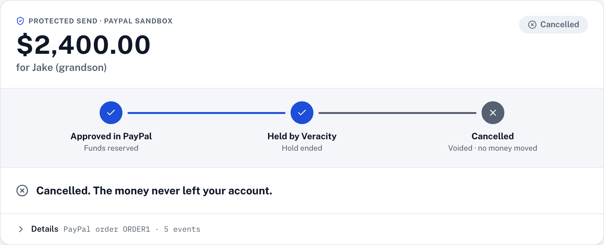
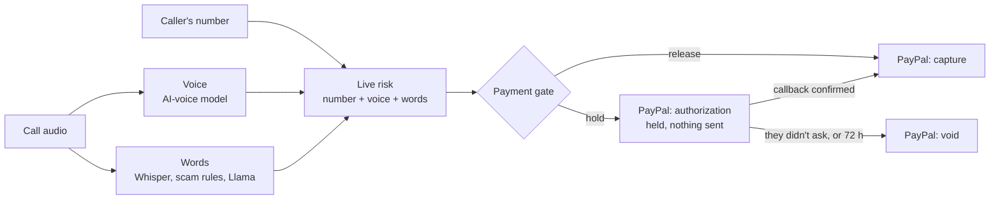
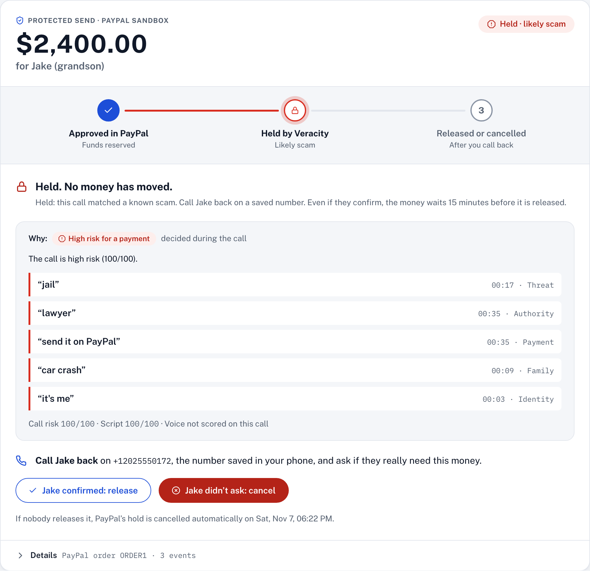
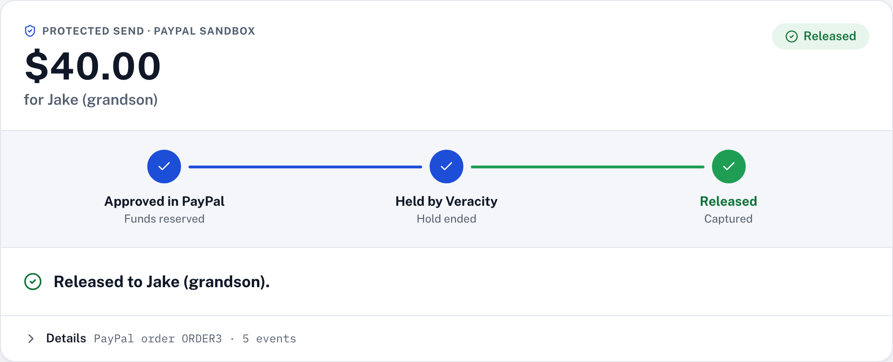
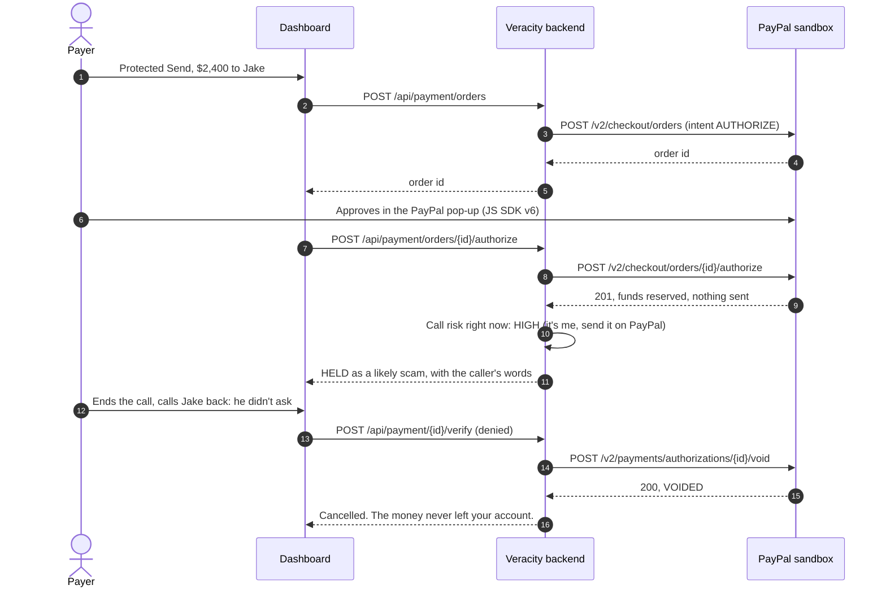
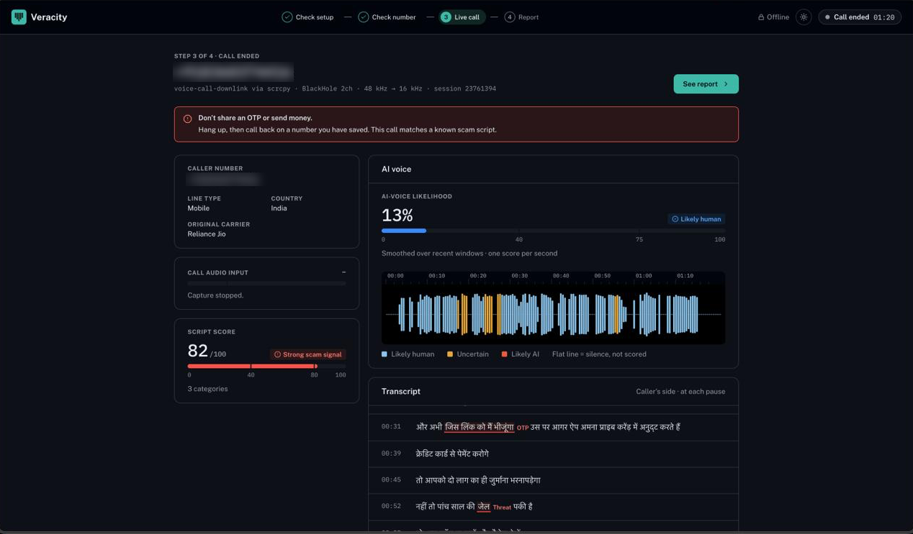

<div align="center">

# Veracity

**Hears scam calls as they happen. If the caller asks for money, PayPal holds it until the call checks out.**




<sub>The "Grandma, it's me" sample call. The payer approved $2,400 in PayPal, Veracity held it, and after a callback ("Jake didn't ask") the authorization was voided.</sub>

<!-- TODO: replace RENDER_URL and VIDEO_URL with the real links -->
**Hosted demo:** `RENDER_URL` · **Demo video:** `VIDEO_URL` · [How PayPal is used](#paypal-integration)

</div>

---

## Try it in 2 minutes

<!-- TODO: fill in RENDER_URL, VIDEO_URL, BUYER_EMAIL and BUYER_PASSWORD (the sandbox personal account from docs/PAYPAL_SETUP.md step 2) -->

| | |
| --- | --- |
| Hosted demo | `RENDER_URL` |
| Demo video | `VIDEO_URL` |
| PayPal sandbox buyer | `BUYER_EMAIL` / `BUYER_PASSWORD` (a sandbox test account with test money; the demo's first screen shows it too) |

1. Open the demo, select **Pick a sample call**, choose **"Grandma, it's me": a grandparent scam**, then **Start the call**.
2. When "Jake" asks for $2,400, the **Protected Send** panel is already filled in. Pay with the PayPal button and log in as the sandbox buyer. PayPal authorizes the payment and Veracity **holds** it, quoting the caller's own words.
3. Select **End call & build report**. The held card now asks you to call Jake back on the number saved in your phone.
4. Select **Jake didn't ask: cancel**. Veracity voids the authorization at PayPal: *"Cancelled. The money never left your account."* Open **Details** to see each PayPal call with its HTTP status and `debug_id`.

Then try **A real grandson asking for concert money**: the $40 is held while the call is on, and released (captured) when it ends.

---

## The problem

- In 2025 the FBI's IC3 counted **$893 million** lost to AI-related scams, including voice-cloned "family in distress" calls.
- Americans aged 60 and over reported **$7.7 billion** stolen, about 60% more than in 2024 ([AARP on the FBI and FTC reports](https://www.aarp.org/money/scams-fraud/fbi-ftc-report-2025-losses.html)).
- The money moves **during the call**, before anyone checks.

---

## How it works



**What happens to the money.** The payer approves in PayPal as usual, but the order's intent is **AUTHORIZE**: PayPal reserves the funds and nothing is sent. The gate then reads the call's risk at that moment ([`decide()` and `gate_level()`](veracity-backend/app/feature/payment_gate.py)), checking these rows from top to bottom:

| When PayPal authorizes, the call… | The money |
| --- | --- |
| is high risk (score ≥ 70), the voice is *Likely AI*, or the words match a known scam script (script ≥ 80) | **Held as a likely scam.** Released only if you call the person back and they confirm, and even then only after a 15-minute cooling-off |
| is still going on | **Held** until the call ends, then decided again with the final report. If the call turns high risk meanwhile, the hold becomes *likely scam* |
| is medium risk, shows some scam signs (script ≥ 40), or the caller says they're someone you know (or describes a family emergency) and asks for money | **Held until you call them back** on the number saved in your phone. "They confirmed" releases it, "they didn't ask" voids it |
| is low risk | **Released**: the authorization is captured. A payment made mid-call is released when the call ends |
| (nobody releases it within 72 hours) | **Voided** automatically, inside PayPal's 3-day honor period. A sweeper checks every held payment once a minute |

"They confirmed" can't be pressed while the call is still on, since the caller could be the one saying it. Cancelling works at any time.

<table>
  <tr>
    <td width="55%"></td>
    <td width="45%"></td>
  </tr>
  <tr>
    <td><sub>Held as a likely scam. The card quotes the caller ("it's me", "send it on PayPal") with timestamps, and asks for a callback on the saved number.</sub></td>
    <td><sub>The real grandson's $40: held while the call was on, released when it ended low risk.</sub></td>
  </tr>
</table>

<sub>These three cards were captured from the hosted build running locally, with PayPal replaced by the tests' stand-in (`tests/fake_paypal.py`), so the order ids under Details are placeholders.</sub>

---

## PayPal integration

Every PayPal call Veracity makes, all against the **sandbox** (`api-m.sandbox.paypal.com`; there's no live switch):

| When | PayPal call | Why |
| --- | --- | --- |
| Before any other call | `POST /v1/oauth2/token` | Client-credentials token, cached until a minute before it expires |
| The user starts a Protected Send | `POST /v2/checkout/orders` with intent `AUTHORIZE` | The payer approves as usual, but approving moves no money |
| The payer approves in the PayPal button | `POST /v2/checkout/orders/{id}/authorize` | Reserves the funds; the gate then decides with the call's risk |
| The call checks out, a callback is confirmed, or a cooling-off ends | `POST /v2/payments/authorizations/{id}/capture` | **Release** |
| The payer cancels, a callback is denied, or 72 hours pass | `POST /v2/payments/authorizations/{id}/void` | **Cancel**: the money never leaves the payer |
| A capture or void fails | `GET /v2/payments/authorizations/{id}` | Record PayPal's real state instead of guessing |
| PayPal sends a webhook (optional, `PAYPAL_WEBHOOK_ID`) | `POST /v1/notifications/verify-webhook-signature` | Only events PayPal signed change a payment; each event id is applied once |
| After a release (optional, `PAYPAL_PAYOUTS=1`) | `POST /v1/payments/payouts` | Forward the money to the recipient's PayPal email |

- **Button:** the payer approves in PayPal's own pop-up, through the JavaScript SDK v6 `PayPalOneTimePaymentButton` from `@paypal/react-paypal-js/sdk-v6` ([`ProtectedSend.jsx`](veracity-frontend/veracity/src/components/payment/ProtectedSend.jsx)).
- **Idempotency:** every request that creates, authorizes, captures, voids or pays out carries a `PayPal-Request-Id`, so a retried request can't do it twice.
- **Audit trail:** each PayPal answer (method, path, HTTP status, `paypal-debug-id`, time) is stored with the payment and shown under **Details** on the card.
- **Code:** [`paypal_client.py`](veracity-backend/app/feature/paypal_client.py) (the REST calls), [`payment_gate.py`](veracity-backend/app/feature/payment_gate.py) (the decisions). Setup, webhooks, Payouts and deploying: [docs/PAYPAL_SETUP.md](docs/PAYPAL_SETUP.md).

The scam path, start to finish:



**What this is, honestly.** The payer pays through Veracity's own Protected Send checkout, because a third-party app can't pause a payment made inside the PayPal app. Veracity adds the one thing a payment system can't see: the phone call.

---

## AI

| Model | Job | Where it runs |
| --- | --- | --- |
| [wav2vec2 XLS-R deepfake classifier](https://huggingface.co/Gustking/wav2vec2-large-xlsr-deepfake-audio-classification) | Scores the last 4 s of the caller's voice every second for how likely it is AI-generated; three windows in a row are needed for *Likely AI* | Phone build, on the laptop |
| Whisper large-v3-turbo, through [faster-whisper](https://github.com/SYSTRAN/faster-whisper) | Transcribes the caller at each pause, in Hindi or English | Phone build, on the laptop |
| Llama 3.1 8B, through [Ollama](https://ollama.com/) (optional) | Reads the transcript for scam tactics the rules miss; a flag is kept only if its quote is really in one transcript line | Phone build, on the laptop |
| Scam rules (plain code, 12 categories) | Flags scam phrases in English, Hinglish and Hindi with the exact words and time, and scores the script 0 to 100 | Both builds |
| Risk fusion and the payment gate (plain code) | Number 25%, voice 40%, script 35%; one strong signal is enough on its own | Both builds |

**The hosted demo replays scripted calls, so the models run only in the phone build.** The demo has no phone and loads no models: sample calls go through the same scam rules, risk fusion, payment gate and real PayPal sandbox. The dashboard's first screen says so ("Needs the phone build"), and the held card says "Voice not scored on this call".



<sub>A real test call in the phone build (31 October 2026, before the UI refresh; the number is blurred). A person read a Hindi "digital arrest" script: the voice stayed <i>Likely human</i>, and the rules caught the script word for word.</sub>

---

## Results: what's measured and what isn't

| What | Result | Source |
| --- | --- | --- |
| Scam rules on 48 written test calls (24 scam, 24 ordinary) | Live alert (script ≥ 80): **6 / 24** scams, **0 / 24** ordinary calls.<br/>Some scam signs (script ≥ 40): **21 / 24** scams, **0 / 24** ordinary calls. | [`eval/results.md`](eval/results.md), from `python eval/run_rules_eval.py` |
| The payment gate on the same 48 calls | **21 / 24** scams held (6 as a likely scam, 15 for a callback), **0 / 24** ordinary calls held | The ≥ 40 and ≥ 80 lines of [`eval/results.md`](eval/results.md); running `decide()` on each call gives the same counts |
| Automated tests | **100 passing**, with no phone, models or PayPal account (PayPal is replaced by [`tests/fake_paypal.py`](veracity-backend/tests/fake_paypal.py)) | `cd veracity-backend && python -m pytest -q` |
| Real PayPal sandbox runs (4 November 2026) | "Grandma, it's me": authorize **201** → void **200**.<br/>Real grandson: authorize **201** → capture **201**. | The payments' audit trails, which record PayPal's status code and `debug_id` for every call |
| Real phone call (31 October 2026) | Hindi "digital arrest" script read by a person: final voice verdict *Likely human* (76 windows scored), 4 red flags, script **82 / 100**, scam alert fired | The saved evidence report, and the screenshot above |
| Voice model on cloned voices | **Not measured yet.** [`eval/voice_eval.py`](eval/voice_eval.py) is ready; results will be added. | — |

<!-- TODO: add a screenshot of the sandbox API Calls log (developer.paypal.com) showing the authorize, void and capture calls, e.g.
 -->

**About the 48 test calls:** they are short transcripts **written for this test, with AI help**, not recordings of real calls. They cover US English, Indian English, Hinglish and Hindi, and include ordinary calls that use the same words as scams (a real bank's fraud check, a delivery driver, a friend asking for $20). The rules were tuned on similar phrasing, so real-world recall will be lower, and on a live call Whisper's mistakes come first.

---

## What's new for this hackathon

| Started at CT BuildFest 2.0 (30–31 October 2026) | Built for the PayPal AI Hackathon |
| --- | --- |
| A live-call detector: Android over USB, scrcpy and BlackHole | **Protected Send**: Orders v2 (intent AUTHORIZE), Payments v2 capture and void, verified webhooks, optional Payouts, the JS SDK v6 button |
| Number check, the AI-voice model, Whisper, 11 scam-rule categories (Indian scripts), the local LLM | **The payment gate**: hold rules, callbacks, cooling-off, escalation, 72-hour auto-void, reconciling with PayPal, audit trail |
| The JSON evidence report | US scam scripts and the "it's me" identity claim (12th category); US reporting (FTC, IC3, Elder Fraud Hotline) |
| 13 tests | Replayed sample calls and the hosted build (Dockerfile, `render.yaml`); the 48-call evaluation and `voice_eval.py`; 100 tests; the MIT license; the redesigned payment card |

Everything PayPal was built for this hackathon. Every commit after `3b7f1298` (31 October 2026) is hackathon work.

---

## Run it yourself

### The hosted build (no phone, no models)

With Docker:

```bash
git clone https://github.com/YADUNANDAN-SINGH/Veracity.git && cd Veracity
docker build -t veracity .
docker run --rm -p 8000:8000 veracity
# Protected Send needs PayPal sandbox keys (docs/PAYPAL_SETUP.md):
docker run --rm -p 8000:8000 -e PAYPAL_CLIENT_ID=... -e PAYPAL_CLIENT_SECRET=... veracity
```

Without Docker (Python 3.12 and Node.js 22, as in the Dockerfile):

```bash
(cd veracity-frontend/veracity && npm ci && npm run build)
cd veracity-backend && python3 -m venv venv && source venv/bin/activate
pip install -r requirements-judge.txt
cp .env.example .env    # PayPal sandbox keys go here (docs/PAYPAL_SETUP.md); empty is fine
VERA_MODE=judge VERA_REGION=US VERA_STATIC_DIR=../veracity-frontend/veracity/dist \
  uvicorn main:app --port 8000 --env-file .env
```

Open <http://localhost:8000>. The hosted demo is this same container on Render ([`render.yaml`](render.yaml)).

### The phone build (Mac + Android)

You need macOS on Apple Silicon, Python 3.12 or 3.13, Node.js 22, and an Android phone with USB debugging on. [Ollama](https://ollama.com/) is optional.

```bash
brew install --cask android-platform-tools   # adb
brew install scrcpy blackhole-2ch            # scrcpy 3.2 or newer

cd veracity-backend
python3 -m venv venv && source venv/bin/activate
pip install -r requirements.txt -r requirements-ml.txt

# Download the models once; after this the call analysis works offline
hf download Gustking/wav2vec2-large-xlsr-deepfake-audio-classification
python -c "from faster_whisper import WhisperModel; WhisperModel('large-v3-turbo', device='cpu', compute_type='int8')"
ollama pull llama3.1:8b                      # optional

cp .env.example .env                         # PayPal sandbox values: docs/PAYPAL_SETUP.md
uvicorn main:app --reload --port 8000 --env-file .env
```

In a second terminal, `cd veracity-frontend/veracity && npm install && npm run dev`, then open <http://localhost:5173>. Vite forwards `/api` and `/ws` to the backend. No phone handy? Start the backend with `VERA_FAKE=1 uvicorn …` to replay the sample calls.

<details>
<summary><b>Connecting the phone</b>: USB debugging, call audio, BlackHole</summary>

<br/>

1. **USB debugging.** Settings → About phone, tap *Build number* 7 times (on Xiaomi, *MIUI version*). In Developer options turn on *USB debugging* (on Xiaomi also *USB debugging (Security settings)*). Plug in with a data cable and accept the prompt; `adb devices` must list the phone as `device`.
2. **Route the call into BlackHole.** scrcpy plays the caller through the Mac's current sound output. In **Audio MIDI Setup**, create a **Multi-Output Device** with your speakers or headphones first, then **BlackHole 2ch** (Drift Correction on BlackHole only), and make it the sound output. Allow Microphone access for the terminal when macOS asks, or BlackHole records silence.
3. **Check the phone shares call audio.** During a real call:

   ```bash
   scrcpy --no-video --no-playback --require-audio --audio-source=voice-call-downlink \
     --audio-codec=aac --record=downlink_test.m4a --time-limit=20
   ```

   If `downlink_test.m4a` is silent, retry with `--audio-source=voice-call` and run the backend with `VERA_AUDIO_SOURCE=voice-call`.
4. **Monitor a call.** Step 1 should be all green. Step 2 fills in the number when the phone rings. Step 3 starts scrcpy and listens; send any money from its **Protected Send** panel. Then **End call & build report**.

Android doesn't let ordinary apps record calls. scrcpy runs its capture code on the phone through `adb`, and since v3.2 it can capture the caller's side of a call. A product would need OEM or operator integration; the cable proves the pipeline end to end.

</details>

<details>
<summary><b>Configuration</b>: environment variables</summary>

<br/>

| Variable | Default | What it does |
| --- | --- | --- |
| `PAYPAL_CLIENT_ID`, `PAYPAL_CLIENT_SECRET` | unset | PayPal **sandbox** REST app; without them Protected Send says it isn't set up |
| `PAYPAL_WEBHOOK_ID` | unset | Turns on `/api/paypal/webhook` and its signature check |
| `PAYPAL_PAYOUTS` | `0` | `1`: after a release, forward the money to the recipient's PayPal email |
| `VERA_SANDBOX_BUYER_EMAIL`, `VERA_SANDBOX_BUYER_PASSWORD` | unset | A **sandbox** test buyer the hosted build shows on its first screen |
| `VERA_MODE` | unset | `judge`: the hosted build. Replays sample calls, skips hardware checks and model loading |
| `VERA_REGION` | `IN` | `US` or `IN`: how numbers are read, and which reporting links the report gives |
| `VERA_FAKE` | unset | `1`: no phone needed; Step 3 replays a sample call |
| `VERA_SCENARIO` | `grandparent_us` (US) or `digital_arrest_in` (IN) | The sample call a replay starts with |
| `VERA_REPLAY_SPEED` | `1` | `2` replays a call twice as fast |
| `VERA_STATIC_DIR` | unset | A built dashboard (`dist/`) for the backend to serve |
| `VERA_DB` | `app/data/veracity.db` | SQLite file for reports, community reports and payments |
| `VERA_CURRENCY` | `USD` | Protected Send's default currency (USD, GBP, EUR, CAD or AUD) |
| `VERA_HOLD_HOURS` | `72` | A hold nobody releases is voided after this long; 72 at most |
| `VERA_COOL_OFF_MIN` | `15` | How long a likely-scam payment still waits after a confirmed callback |
| `VERA_AUDIO_DEVICE` | `BlackHole 2ch` | Input device to record from |
| `VERA_AUDIO_SOURCE` | `voice-call-downlink` | scrcpy audio source; `voice-call` mixes both sides |
| `VERA_VOICE_MODEL` | `Gustking/wav2vec2-large-xlsr-deepfake-audio-classification` | Hugging Face model for the AI-voice score |
| `VERA_VOICE_T`, `VERA_T_AI`, `VERA_T_UNCERTAIN` | `1.0`, `0.75`, `0.40` | Calibration temperature, and the *Likely AI* and *Uncertain* thresholds |
| `VERA_WHISPER_MODEL`, `VERA_WHISPER_THREADS` | `large-v3-turbo`, up to 8 | Whisper size (use `small` on a slower Mac) and CPU threads |
| `VERA_LANGUAGE` | `hi` | `hi`, `en`, or `auto` |
| `VERA_LLM_MODEL`, `OLLAMA_HOST` | `llama3.1:8b`, `http://localhost:11434` | The local LLM |

</details>

<details>
<summary><b>API</b>: REST endpoints and the WebSocket</summary>

<br/>

| Method | Path | Purpose |
| --- | --- | --- |
| GET | `/api/health` | Backend, phone and model status; mode, region and PayPal setup |
| GET | `/api/call/state` | Ringing, in call, and the caller's number, read over adb |
| POST | `/api/number/check` | A number's facts, series, community reports and rule score |
| POST | `/api/number/report` | Save a community report |
| GET | `/api/session/scenarios` | The sample calls that can be replayed |
| POST | `/api/session/start` | Start monitoring (or replaying) a call |
| POST | `/api/session/{id}/say` | A replayed call hears this as the caller's next words |
| GET | `/api/session/{id}/risk` | The call's risk so far |
| POST | `/api/session/{id}/stop` | End the call, decide payments that waited for it, save the report |
| GET | `/api/report/{id}` | A saved report, with its payments as they are now; `?download=1` sends it as a file |
| WS | `/ws/live/{id}` | Live events: level, voice, transcript, flag, script, alert, report |
| GET | `/api/payment/config` | Whether PayPal is set up, the sandbox client id, currencies, hold policy |
| POST | `/api/payment/orders` | Create the PayPal order (intent AUTHORIZE) |
| POST | `/api/payment/orders/{order_id}/authorize` | After the payer approves: authorize, then hold or release |
| GET | `/api/payment?session_id=` | A call's payments, each with its policy and audit trail |
| GET | `/api/payment/{id}` | One payment, brought up to date |
| POST | `/api/payment/{id}/verify` | `{outcome: "confirmed" \| "denied"}` after the callback |
| POST | `/api/payment/{id}/cancel` | Void the authorization |
| POST | `/api/paypal/webhook` | PayPal webhooks, signature checked before anything changes |

Interactive docs are at <http://localhost:8000/docs> while the backend runs.

</details>

<details>
<summary><b>Troubleshooting</b></summary>

<br/>

| Problem | Fix |
| --- | --- |
| Protected Send says PayPal isn't set up | Set `PAYPAL_CLIENT_ID` and `PAYPAL_CLIENT_SECRET` from a **sandbox** app, and start the backend with `--env-file .env` |
| The PayPal button doesn't appear | The browser couldn't load PayPal's SDK: check for an ad blocker, and that the client id is the sandbox one |
| The PayPal pop-up won't take your login | Use a sandbox **personal** test account, not a real PayPal login |
| A payment stays *Held* | That's the gate working: end the call, call the person back, then choose *confirmed* or *didn't ask* |
| Webhooks return 400 | `PAYPAL_WEBHOOK_ID` must be the id of the webhook PayPal is sending to; the webhook simulator's events can't be verified, so test with a real sandbox payment |
| **No call audio** banner, flat waveform | The Mac's sound output doesn't include BlackHole: set up the Multi-Output Device |
| **No phone found** | Run `adb devices`; replug, set USB mode to *File transfer*, accept the debugging prompt |
| Transcript in the wrong language, or lagging | Set `VERA_LANGUAGE`; on a slower Mac use `VERA_WHISPER_MODEL=small` |
| No *local LLM* flags | Start Ollama and `ollama pull llama3.1:8b`; the rules work without it |
| `address already in use` | Another copy is running on port 8000 (often Docker): stop it |

</details>

---

## Architecture and repo layout

The backend keeps web code in `routes/` and logic in `feature/`, so every feature is tested without a server. The dashboard goes `api/` → `hooks/` → `pages/` → `components/`.

```text
Veracity/
├── Dockerfile · render.yaml           the hosted build: one container, a Render Blueprint
├── docs/PAYPAL_SETUP.md               sandbox app, test buyer, webhooks, Payouts, deploying
├── eval/
│   ├── transcripts.jsonl              48 written test calls: 24 scam, 24 ordinary
│   ├── run_rules_eval.py              → eval/results.md
│   └── voice_eval.py                  the voice model on recordings → voice_results.md
├── veracity-backend/                  Python · FastAPI
│   ├── main.py                        app, routers, the held-payment sweeper; serves the dashboard
│   ├── app/feature/
│   │   ├── paypal_client.py           PayPal REST: OAuth, Orders v2, Payments v2, Payouts, webhooks
│   │   ├── payment_gate.py            hold, release or void by the call's risk; audit trail
│   │   ├── scam_rules.py              12 categories, US and Indian scripts, Hindi-tolerant matching
│   │   ├── report.py                  risk fusion, evidence report, next steps per region
│   │   ├── session.py · replay.py     a live call, or a sample call, through the same pipeline
│   │   └── voice.py · transcriber.py · scam_llm.py   the three models (phone build)
│   ├── app/scenarios/                 the sample calls the hosted build replays
│   └── tests/                         100 tests; fake_paypal.py stands in for PayPal
└── veracity-frontend/veracity/        React 19 · Vite · PayPal JS SDK v6
    └── src/components/payment/        ProtectedSend.jsx (the PayPal button), PaymentGate.jsx (the card)
```

---

## Privacy and limitations

### Privacy

- The call's audio is analysed in memory on the laptop and **isn't saved** unless the user turns on *Save call audio*; then the report stores the file's SHA-256.
- **PayPal gets the payment, never the call:** the amount, the currency, a description with the recipient's name, and the payment's and call's ids. No audio, transcript or scores.
- The models run on the laptop. The only outside service is PayPal's.

### Limitations

- **The voice model is unproven on cloned voices.** It hasn't been measured on them yet.
- **Money must go through Protected Send.** Veracity can't pause a payment made in the PayPal app or anywhere else.
- **Gift cards, wires, crypto and cash** can only be warned about during the call; the report says where to report it.
- **Sandbox only**, with test money.
- **The scam-rule evaluation is small and written**, not recorded (see [Results](#results-whats-measured-and-what-isnt)).
- **Not proof.** *Likely AI* is a model estimate meant to warn, and every report says so. Veracity checks the caller ID the network shows, and can't unmask a spoofed number.
- **Hardware.** The phone build needs a laptop and a USB cable, and call-audio support varies by phone.

---

## What's next

- Measure the voice model on consented cloned-voice recordings with `eval/voice_eval.py`, and calibrate it on real phone audio.
- Offer the call verdict as a risk signal that PayPal's own send flow could consult, instead of a separate checkout.
- Run without the laptop and cable, through an on-device or operator integration.

---

## AI tools used

- **In the product:** the wav2vec2 XLS-R deepfake classifier, Whisper large-v3-turbo (faster-whisper) and Llama 3.1 8B (Ollama), as described in [AI](#ai). The scam rules, risk fusion and payment gate are plain code, so every decision can be explained with the caller's own words.
- **To build it:** Claude (Anthropic) was used as a coding assistant for the PayPal integration, the hosted build, the tests, the evaluation scripts, the UI and this README. The 48 test transcripts in `eval/` were written with its help.

<!-- TODO: add any other AI tools used to build Veracity (for example during CT BuildFest) and what each was used for. -->

---

## Team and credits

<!-- TODO: team names, roles and links -->
`TEAM_NAMES`

Built on [scrcpy](https://github.com/Genymobile/scrcpy), [BlackHole](https://github.com/ExistentialAudio/BlackHole), [faster-whisper](https://github.com/SYSTRAN/faster-whisper), [Ollama](https://ollama.com/), [Hugging Face Transformers](https://github.com/huggingface/transformers), [python-phonenumbers](https://github.com/daviddrysdale/python-phonenumbers), [FastAPI](https://fastapi.tiangolo.com/), [React](https://react.dev/), [Vite](https://vite.dev/), [@paypal/react-paypal-js](https://github.com/paypal/react-paypal-js) and the [PayPal REST APIs](https://developer.paypal.com/api/rest/).

## License

MIT. See [LICENSE](LICENSE).
